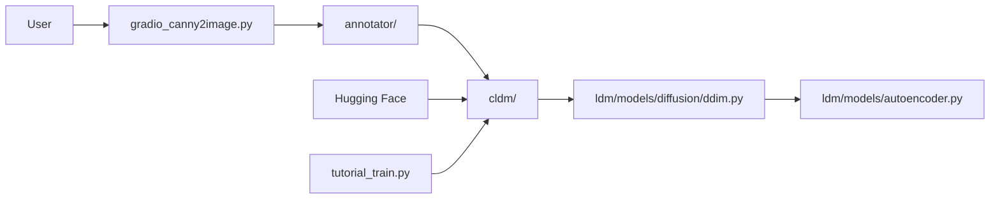

# lllyasviel/ControlNet

> Official implementation of ControlNet 1.0 for conditioning Stable Diffusion 1.5, aimed at researchers.

## The problem
A text prompt alone cannot impose a pose, outlines or depth on a generated image.

## What it actually does
A "locked" copy and a "trainable" copy of the SD encoder blocks, linked by zero convolutions: you add control without damaging the model.
Nine Gradio apps: Canny, M-LSD, HED, scribbles, pose, segmentation, depth, normals.
Annotators (`annotator/`) to produce the conditioning maps; "guess mode" without a prompt.
Training scripts on your own pairs (`tutorial_train.py`).

## How it is wired


## Trying it
```bash
conda env create -f environment.yaml
conda activate control
python gradio_canny2image.py
```

## Cost and gotchas
GPU required; SD weights and detectors must be downloaded manually from Hugging Face. Last push in February 2024.

## What it is not
Not for SDXL or recent models: it targets SD 1.5. Not a polished user interface (Gradio, drawing outside the UI). The anime model is not released.

## Alternatives
- Mikubill A1111 WebUI Plugin: ControlNet integrated into WebUI, multi-ControlNet.
- ControlNet-for-Diffusers: port to diffusers.
- T2I-Adapter: a smaller control model.

## For you
Educational value (read the paper and the code); in practice, go through diffusers.
