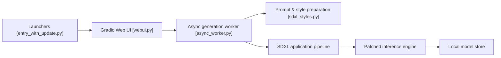

# lllyasviel/Fooocus

> A local image generator based on SDXL and Gradio, for producing images by tuning almost only the prompt.

## The problem
Online image generators are paid and opaque; local interfaces require a lot of manual tuning.

## What it actually does
A Gradio interface that launches an asynchronous worker: text to image, variations and upscaling, inpaint/outpaint, image prompt, image description. A local GPT-2 engine expands the prompt ("Fooocus V2" style). Three presets (default, realistic, anime) and a patched inference engine (`ldm_patched`). Models are downloaded on first launch.

## How it is wired


## Trying it
```bash
git clone https://github.com/lllyasviel/Fooocus.git
cd Fooocus
conda env create -f environment.yaml
conda activate fooocus
pip install -r requirements_versions.txt
python entry_with_update.py
python entry_with_update.py --preset anime
```

## Cost and gotchas
Nvidia GPU with at least 4 GB of VRAM and 8 GB of RAM, swap required; 40 GB free recommended in case of a CPUAllocator error. The first launch downloads several GB of models from Hugging Face. `--listen` and `--share` expose the interface without authentication unless you add `auth.json`.

## What it is not
It is not suited to recent models: the README itself says its tricks rely on SDXL and are no longer very up to date. On Mac or AMD, support is in beta and much slower.

## Alternatives
- ComfyUI: node graph, more control but more settings.
- AUTOMATIC1111 (cited for reweighting): larger ecosystem.
- mashb1t/Fooocus, RuinedFooocus: forks listed in the README.

## For you
Worth watching: a good playground to understand a local SDXL pipeline, but GPL-3.0 and an SDXL-centered engine; don't make it a lasting building block.
