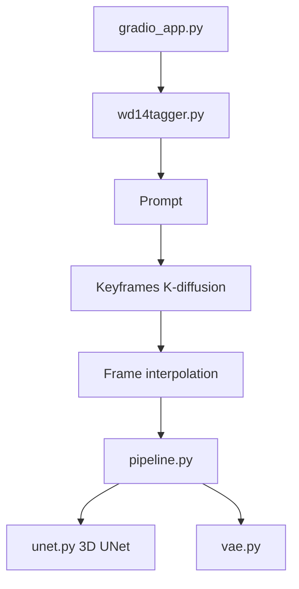

# lllyasviel/Paints-UNDO

> Models that generate the drawing process of a digital artwork as a series of undo steps.

## The problem
Drawing AIs produce a final result without understanding how an artist builds an image, step by step.

## What it actually does
From a finished image, a single-frame model (modified SD1.5, step 0 to 999) generates 5 to 7 keyframes, then a multi-frame model (VideoCrafter-like, 16 intermediate frames) interpolates them. Result: a video of about 25 s at 4 frames/s in 320x512. Gradio interface, WD14 tags required.

## How it is wired


## Trying it
```bash
git clone https://github.com/lllyasviel/Paints-UNDO.git
cd Paints-UNDO
conda create -n paints_undo python=3.10
conda activate paints_undo
pip install xformers
pip install -r requirements.txt
python gradio_app.py
```

## Cost and gotchas
Tested with 24 GB of VRAM; 16 GB may work, 8 GB will not. Expect 5 to 10 minutes per image. Many fake sites exist: the GitHub repo is the only official page.

## What it is not
Not an editor or an online service. Not a real trace of the artist's work: it is a generated simulation. No examples on the page itself.

## Alternatives
No alternative named as a replacement; the README cites related work (Stylized Neural Painting, Paint Transformer, ProcessPainter).

## For you
Ignore: a niche creative use case, heavy GPU needs and a repo with no push since August 2025; it remains interesting to read as a study of diffusion models.
