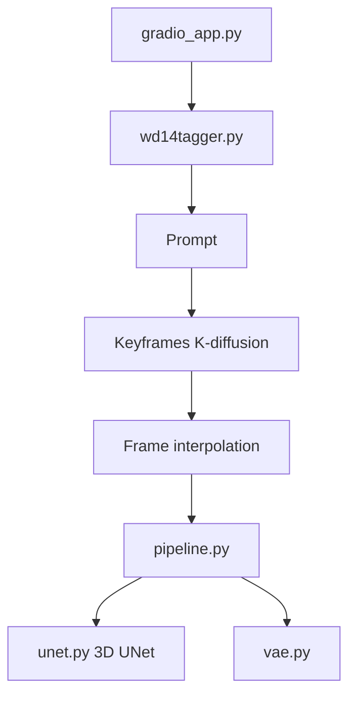

# lllyasviel/Paints-UNDO

> Modèles qui génèrent le déroulé de dessin d'une œuvre numérique comme une série d'annulations.

## Le problème
Les IA de dessin produisent un résultat final sans comprendre comment un artiste construit une image, étape par étape.

## Ce que ça fait vraiment
À partir d'une image finie, un modèle monoframe (SD1.5 modifié, étape 0 à 999) génère 5 à 7 images clés, puis un modèle multiframe (type VideoCrafter, 16 images intermédiaires) les interpole. Résultat : une vidéo d'environ 25 s à 4 images/s en 320x512. Interface Gradio, étiquettes WD14 obligatoires.

## Comment c'est branché


## Essayer
```bash
git clone https://github.com/lllyasviel/Paints-UNDO.git
cd Paints-UNDO
conda create -n paints_undo python=3.10
conda activate paints_undo
pip install xformers
pip install -r requirements.txt
python gradio_app.py
```

## Coût et pièges
Testé avec 24 Go de VRAM ; 16 Go peut passer, 8 Go non. Compter 5 à 10 minutes par image. Beaucoup de faux sites existent : le dépôt GitHub est la seule page officielle.

## Ce que ce n'est pas
Pas un éditeur ni un service en ligne. Pas une trace réelle du travail de l'artiste : c'est une simulation générée. Pas d'exemples sur la page elle-même.

## Alternatives
Aucune alternative nommée comme remplaçant ; le README cite des travaux liés (Stylized Neural Painting, Paint Transformer, ProcessPainter).

## Pour toi
À ignorer : cas d'usage créatif de niche, GPU lourd et dépôt sans push depuis août 2025 ; la lecture reste intéressante comme étude de modèles de diffusion.

