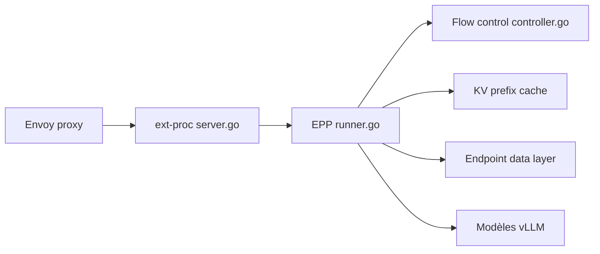

# llm-d/llm-d-router

> Kubernetes inference router that places LLM requests according to load and the KV cache.

## The problem
Spreading traffic across model replicas without accounting for the prefix cache and load wastes GPU.

## What it actually does
The Endpoint Picker (EPP) evaluates each request against the state of the InferencePool (KV cache locality, load, priority) and chooses the endpoint, via Envoy's ext-proc protocol. Adds the InferenceObjective and InferenceModelRewrite APIs, flow control, and a sidecar for P/D and E/P/D disaggregation. Two modes: standalone (Helm, Envoy) or Gateway API.

## How it is wired

## Trying it
No command documented in the README (it points to the Helm chart, `config/charts/README.md`).

## Cost and gotchas
Assumes a Kubernetes cluster, model servers and GPUs. Only Envoy's `FULL_DUPLEX_STREAMED` mode is supported. 334 open issues.

## What it is not
Not an inference server: it routes to existing servers. "Inference Scheduler" is the former name.

## Alternatives
- Gateway API Inference Extension: now hosts the InferencePool API.

## For you
Worth watching: useful if you operate multi-replica LLM serving on Kubernetes; otherwise too much infrastructure.
