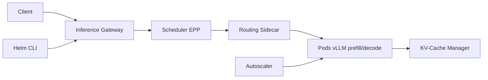

# llm-d/llm-d

> Distributed LLM inference stack for Kubernetes, on top of vLLM, to serve at scale on any accelerator.

## The problem
Serving LLMs in production requires spreading the load intelligently, managing the KV cache and sizing GPUs. Manual tuning is slow and fragile.

## What it actually does
Provides guides, Helm charts and benchmarked recipes to orchestrate model servers (vLLM, SGLang): routing aware of cache prefix and load, KV offload to CPU/disk, prefill/decode disaggregation, expert-parallelism, multi-tenant flow control, SLO autoscaling, OpenAI-compatible Batch API. CNCF sandbox project, founded by Red Hat, Google Cloud, IBM Research, CoreWeave and NVIDIA.

## How it is wired


## Trying it
```bash
# Aucune commande dans le README fourni :
# suivre le Quickstart Guide puis l'Optimized Baseline
```

## Cost and gotchas
A Kubernetes cluster and GPUs or accelerators (NVIDIA, AMD) are at your expense. The performance figures cited come from partners and their blogs: reproduce them on your hardware.

## What it is not
Not an inference engine: it relies on vLLM or SGLang. Nor is it designed for a laptop or a single server.

## Alternatives
- vLLM and SGLang: model engines that llm-d builds on.

## For you
Adopt for an MLOps team serving LLMs on Kubernetes: CNCF governance, backing from major players and validated recipes reduce the time to reach production level.
