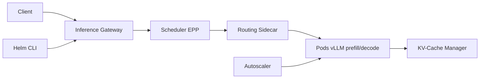

# llm-d/llm-d

> Pile Kubernetes d'inférence LLM distribuée, au-dessus de vLLM, pour servir à grande échelle sur tout accélérateur.

## Le problème
Servir des LLM en production exige de répartir la charge intelligemment, gérer le cache KV et dimensionner les GPU. Le réglage à la main est long et fragile.

## Ce que ça fait vraiment
Fournit guides, charts Helm et recettes benchmarkées pour orchestrer des serveurs de modèles (vLLM, SGLang) : routage conscient du préfixe de cache et de la charge, offload KV vers CPU/disque, désagrégation prefill/decode, expert-parallelism, flow control multi-locataire, autoscaling SLO, API Batch compatible OpenAI. Projet CNCF sandbox, fondé par Red Hat, Google Cloud, IBM Research, CoreWeave et NVIDIA.

## Comment c'est branché


## Essayer
```bash
# Aucune commande dans le README fourni :
# suivre le Quickstart Guide puis l'Optimized Baseline
```

## Coût et pièges
Cluster Kubernetes et GPU ou accélérateurs (NVIDIA, AMD) à ta charge. Les chiffres de performance cités viennent de partenaires et de leurs blogs : à reproduire sur ton matériel.

## Ce que ce n'est pas
Pas un moteur d'inférence : il s'appuie sur vLLM ou SGLang. Pas non plus conçu pour un laptop ou un serveur unique.

## Alternatives
- vLLM et SGLang : moteurs de modèles sur lesquels s'appuie llm-d.

## Pour toi
À adopter pour une équipe MLOps qui sert des LLM sur Kubernetes : gouvernance CNCF, soutien d'acteurs majeurs et recettes validées réduisent le temps de mise au niveau de production.

