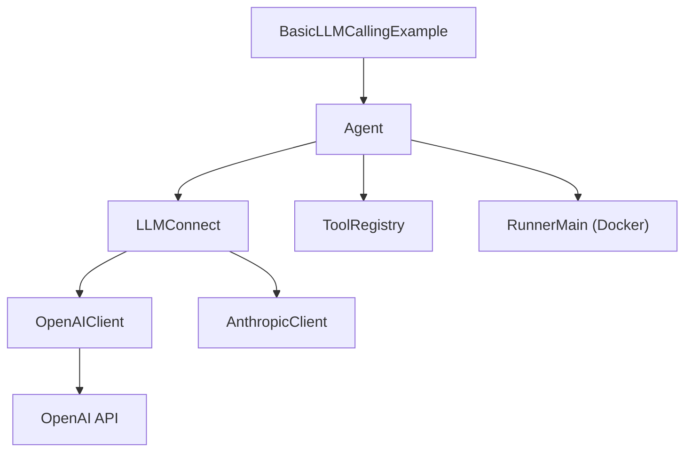

# llm4s/llm4s

> Scala library for building LLM applications on the JVM: clients, agents, tools, RAG.

## The problem
Almost all LLM tooling is in Python. A JVM team must either switch language or hand-assemble HTTP clients, tool calls and traces.

## What it actually does
- A single client for several providers (OpenAI, Anthropic, Gemini, Ollama, etc.), each in its own Maven module.
- An agent framework with tool calling, memory, guardrails, RAG and RAGAS-style evaluation.
- Tracing (console, Langfuse, OpenTelemetry) and tool execution in an isolated Docker container.
- Since 0.5.0, the repository is split into modules; the API remains unstable before 1.0.

## How it is wired


## Trying it
```bash
sbt compile
sbt "samples/runMain org.llm4s.samples.cookbook.StructuredOutputRecipe"
sbt "samples/runMain org.llm4s.samples.basic.BasicLLMCallingExample"
```
In your project: add `"org.llm4s" %% "llm4s-core"` and a provider module (`llm4s-openai`) to `build.sbt`, version 0.5.1.

## Cost and gotchas
You need JDK 21, sbt and Scala 3.7.1 (the README offers nothing else); Docker only for the isolated workspace. A cloud API key, or Ollama locally. The cookbook recipes run without a key.

## What it is not
Not a 1.0 release: APIs may still change. Not a Python library nor a local inference layer. The agent framework is not a service to host.

## Alternatives
- LangChain4j: more established JVM ecosystem (compared in the README).
- Spring AI: direct Spring integration.
- Koog: another JVM framework cited by the README.

## For you
Worth watching only if your stack is Scala or JVM; in Python, it is not your tool, and the API is not frozen before 1.0.
