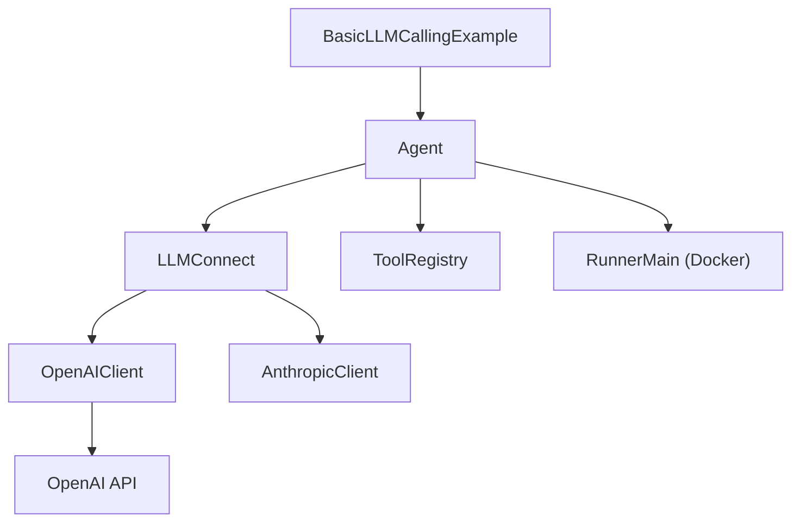

# llm4s/llm4s

> Bibliothèque Scala pour bâtir des applications LLM sur la JVM : clients, agents, outils, RAG.

## Le problème
Presque tout l'outillage LLM est en Python. Une équipe JVM doit soit changer de langage, soit assembler à la main clients HTTP, appels d'outils et traces.

## Ce que ça fait vraiment
- Un client unique pour plusieurs fournisseurs (OpenAI, Anthropic, Gemini, Ollama, etc.), chacun dans son module Maven.
- Un cadre d'agents avec appel d'outils, mémoire, garde-fous, RAG et évaluation de type RAGAS.
- Traçage (console, Langfuse, OpenTelemetry) et exécution des outils dans un conteneur Docker isolé.
- Depuis la 0.5.0, le dépôt est découpé en modules ; l'API reste instable avant la 1.0.

## Comment c'est branché


## Essayer
```bash
sbt compile
sbt "samples/runMain org.llm4s.samples.cookbook.StructuredOutputRecipe"
sbt "samples/runMain org.llm4s.samples.basic.BasicLLMCallingExample"
```
Côté projet : ajouter `"org.llm4s" %% "llm4s-core"` et un module fournisseur (`llm4s-openai`) dans `build.sbt`, version 0.5.1.

## Coût et pièges
Il faut JDK 21, sbt et Scala 3.7.1 (le README ne propose rien d'autre) ; Docker seulement pour l'espace de travail isolé. Une clé d'API cloud, ou Ollama en local. Les recettes du cookbook tournent sans clé.

## Ce que ce n'est pas
Pas une version 1.0 : les API peuvent encore bouger. Pas une bibliothèque Python ni une couche d'inférence locale. Le cadre d'agents n'est pas un service à héberger.

## Alternatives
- LangChain4j : écosystème JVM plus établi (comparé dans le README).
- Spring AI : intégration directe à Spring.
- Koog : autre cadre JVM cité par le README.

## Pour toi
À surveiller seulement si ta stack est Scala ou JVM ; en Python, ce n'est pas ton outil, et l'API n'est pas figée avant la 1.0.

