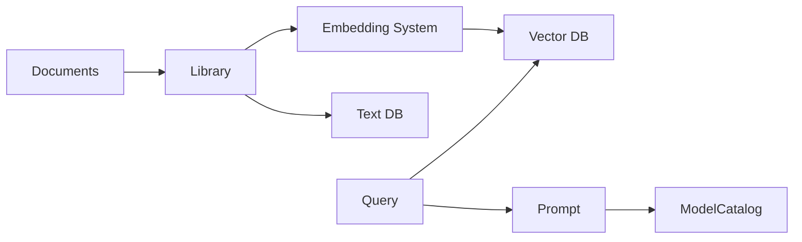

# llmware-ai/llmware

> Python framework for local, private RAG, with a catalog of small specialized models.

## The problem
Building an enterprise RAG on a laptop or at the edge means assembling parsing, chunking, embeddings, a vector database and quantized inference.

## What it actually does
`ModelCatalog`: uniform access to 300+ models (GGUF, OpenVINO, ONNX, PyTorch), including the in-house BLING, DRAGON, SLIM series.
`Library`: multi-format ingestion, chunking, embeddings installed on Milvus, ChromaDB, PGVector, Qdrant, FAISS…
`Query`: text, semantic, hybrid search, filters; `Prompt` with sources and evidence checking.
`LLMfx`: function-calling agents via SLIM models.

## How it is wired


## Trying it
```bash
pip3 install llmware
git clone git@github.com:llmware-ai/llmware.git
sh ./welcome_to_llmware.sh
curl -o docker-compose.yaml https://raw.githubusercontent.com/llmware-ai/llmware/main/docker-compose.yaml
docker compose up -d
```

## Cost and gotchas
Free; GGUF recommends at least 16 GB of RAM. Mongo/Milvus/Postgres via Docker to scale up.

## What it is not
Not a general-purpose orchestrator: it pushes its own models. Cloud models (OpenAI, Anthropic) remain at your expense.

## Alternatives
No alternative named in the README.

## For you
Worth watching: interesting for RAG on CPU/NPU without cloud, but the ecosystem is centered on its in-house models, less standard than the mainstream frameworks.
