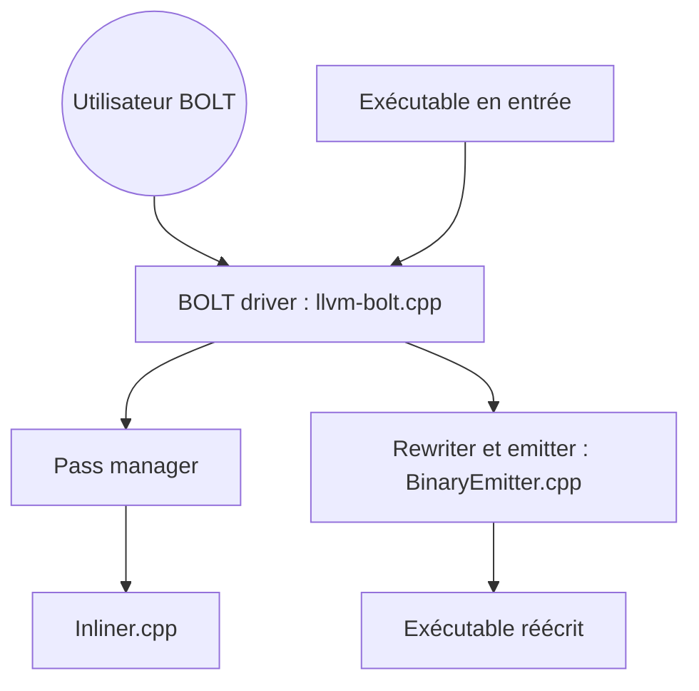

# llvm/llvm-project

> Toolchain for building compilers and optimizers (LLVM, Clang, LLD, libc++), for systems developers.

## The problem
Writing a compiler or an optimizer from scratch is enormous; you need an intermediate representation and shared tools.

## What it actually does
The LLVM core processes intermediate representations and converts them into object files (assembler, disassembler, bitcode analyzer and optimizer). Clang compiles C, C++, Objective-C. Added to this are libc++ and the LLD linker. The architecture provided describes only BOLT, a post-link binary optimizer; it does not cover the whole repository.

## How it is wired


## Trying it
```bash
# Aucune commande dans le README.
# Il renvoie à la page "Getting Started with LLVM" pour la compilation.
```

## Cost and gotchas
Free, but compiling is heavy: the README gives no figures. License present but not identified by GitHub: to be checked. Giant repository, 41,985 open issues.

## What it is not
Not a single program: a set of components. Not an end-user tool. The diagram provided shows only BOLT.

## Alternatives
No alternative named in the README.

## For you
Worth watching: a building block hidden behind Clang and many compilers (including those serving AI), but you will use it indirectly, rarely compiling it yourself.
