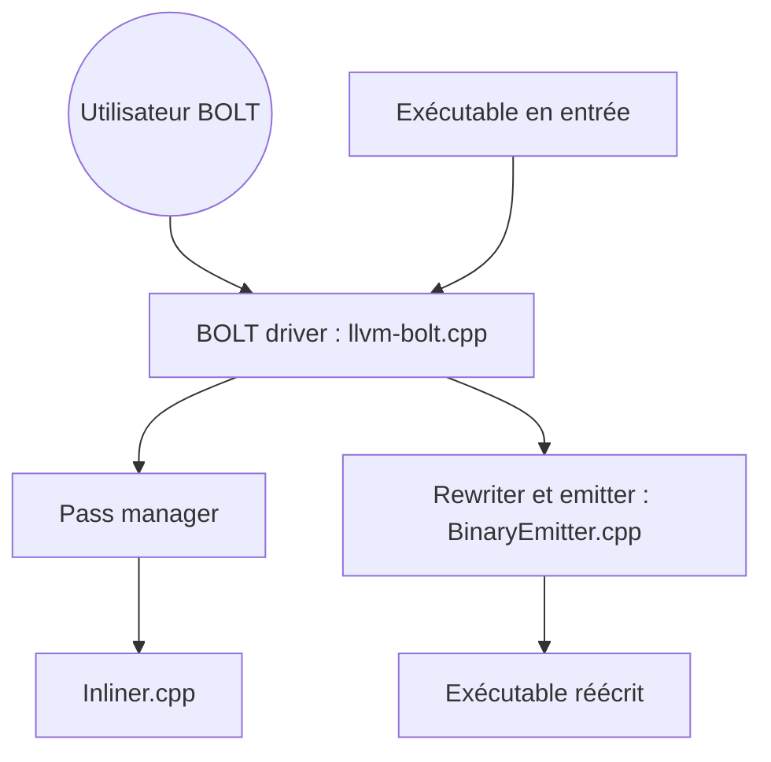

# llvm/llvm-project

> Chaîne d'outils pour construire des compilateurs et optimiseurs (LLVM, Clang, LLD, libc++), pour développeurs de systèmes.

## Le problème
Écrire un compilateur ou un optimiseur de zéro est énorme ; il faut une représentation intermédiaire et des outils partagés.

## Ce que ça fait vraiment
Le cœur LLVM traite des représentations intermédiaires et les convertit en fichiers objets (assembleur, désassembleur, analyseur et optimiseur de bitcode). Clang compile C, C++, Objective-C. S'ajoutent libc++ et le linker LLD. L'architecture fournie ne décrit que BOLT, un optimiseur de binaires après édition de liens ; elle ne couvre pas tout le dépôt.

## Comment c'est branché


## Essayer
```bash
# Aucune commande dans le README.
# Il renvoie à la page "Getting Started with LLVM" pour la compilation.
```

## Coût et pièges
Gratuit, mais la compilation est lourde : le README ne donne pas de chiffres. Licence présente mais non identifiée par GitHub : à vérifier. Dépôt géant, 41 985 issues ouvertes.

## Ce que ce n'est pas
Pas un seul programme : un ensemble de composants. Pas un outil pour utilisateur final. Le schéma fourni ne représente que BOLT.

## Alternatives
Aucune alternative nommée dans le README.

## Pour toi
À surveiller : brique cachée derrière Clang et de nombreux compilateurs (dont ceux qui servent l'IA), mais tu l'utiliseras indirectement, rarement en la compilant toi-même.

