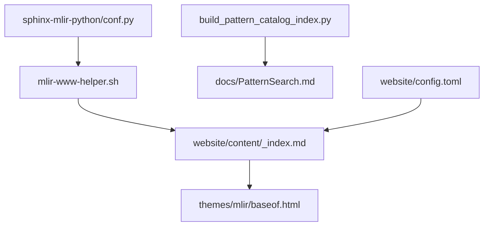

# llvm/mlir-www

> Source code of the mlir.llvm.org website, generated with Hugo, for MLIR documentation contributors.

## The problem
The MLIR documentation must stay in sync with the LLVM monorepo sources.

## What it actually does
Hugo site whose Markdown pages are in `website/content`. Much of the documentation is generated from the MLIR sources by scripts. A GitHub Actions workflow deploys on every push and every 4 hours. The `mlir` theme provides templates and JavaScript.

## How it is wired


## Trying it
```bash
gh repo clone llvm/mlir-www -- --single-branch --branch main
hugo server   # depuis le dossier website, après le workflow main.yml
```

## Cost and gotchas
Free. Reproducing the whole site locally follows the steps in `.github/workflows/main.yml`. No license declared.

## What it is not
Not MLIR: only its website. The compiler and its libraries live elsewhere; this repo contains only the documentation pages.

## Alternatives
No alternative named in the README.

## For you
Ignore: source of a documentation site, to be read online rather than cloned.
