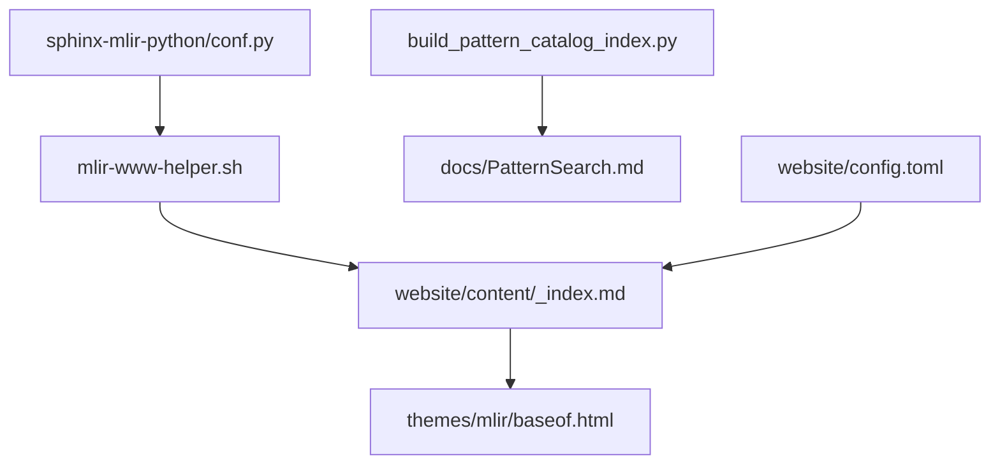

# llvm/mlir-www

> Code source du site mlir.llvm.org, généré avec Hugo, pour contributeurs à la documentation MLIR.

## Le problème
La documentation MLIR doit rester synchronisée avec les sources du monorepo LLVM.

## Ce que ça fait vraiment
Site Hugo dont les pages Markdown sont dans `website/content`. Une grande partie de la documentation est générée depuis les sources MLIR par des scripts. Un workflow GitHub Actions déploie à chaque push et toutes les 4 heures. Le thème `mlir` fournit gabarits et JavaScript.

## Comment c'est branché


## Essayer
```bash
gh repo clone llvm/mlir-www -- --single-branch --branch main
hugo server   # depuis le dossier website, après le workflow main.yml
```

## Coût et pièges
Gratuit. Reproduire tout le site en local suit les étapes de `.github/workflows/main.yml`. Aucune licence déclarée.

## Ce que ce n'est pas
Pas MLIR : seulement son site web. Le compilateur et ses bibliothèques vivent ailleurs ; ce dépôt ne contient que les pages de documentation.

## Alternatives
Aucune alternative nommée dans le README.

## Pour toi
Ignorer : source d'un site de documentation, à lire en ligne plutôt qu'à cloner.

