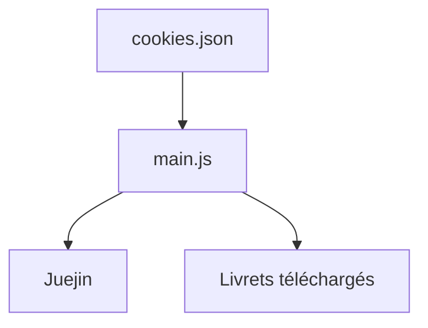

# lm-rebooter/NuggetsBooklet

> Node script that downloads Juejin booklets using your account's cookies.

## The problem
Reading the Chinese platform Juejin's booklets offline is not provided for by the site.

## What it actually does
After `npm install`, you export your Juejin cookies as JSON into `cookies.json`, then `node main.js` starts the download. The README is only a few lines long, in Chinese: internal workings are undocumented.

## How it is wired
Simplified diagram based on the sheet, no diagram provided.



## Trying it
```bash
npm install
node main.js
```

## Cost and gotchas
Free, but you need a Juejin account and must export its cookies. No license; the README limits use to personal, non-commercial study.

## What it is not
Not a general download tool: it targets a single site and depends on your session.

## Alternatives
No alternative named in the README.

## For you
Ignore: Chinese script with no license or documentation, unrelated to your work.
