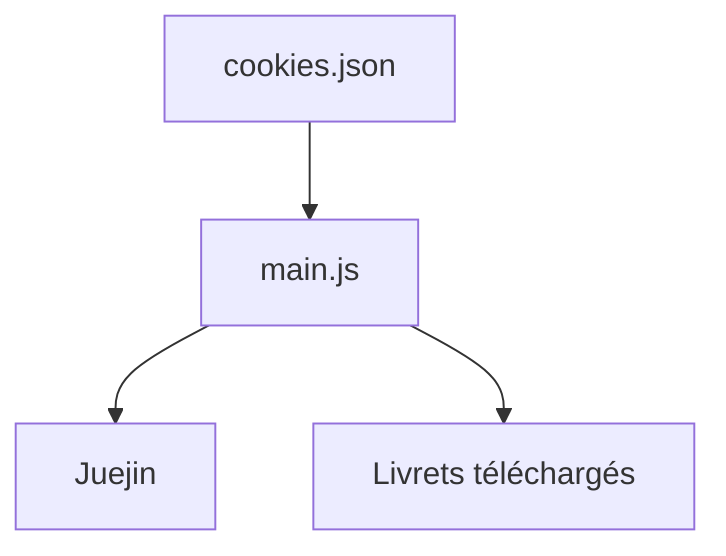

# lm-rebooter/NuggetsBooklet

> Script Node qui télécharge des livrets de Juejin avec les cookies de ton compte.

## Le problème
Lire hors ligne les livrets de la plateforme chinoise Juejin n'est pas prévu par le site.

## Ce que ça fait vraiment
Après `npm install`, on exporte ses cookies Juejin en JSON dans `cookies.json`, puis `node main.js` lance le téléchargement. Le README tient en quelques lignes, en chinois : fonctionnement interne non documenté.

## Comment c'est branché
Schéma simplifié d'après la fiche, sans diagramme fourni.



## Essayer
```bash
npm install
node main.js
```

## Coût et pièges
Gratuit, mais il faut un compte Juejin et l'export de ses cookies. Aucune licence ; le README limite l'usage à l'étude personnelle, non commerciale.

## Ce que ce n'est pas
Pas un outil général de téléchargement : il vise un seul site et dépend de ta session.

## Alternatives
Aucune alternative nommée dans le README.

## Pour toi
À ignorer : script chinois sans licence ni documentation, sans rapport avec ton métier.

