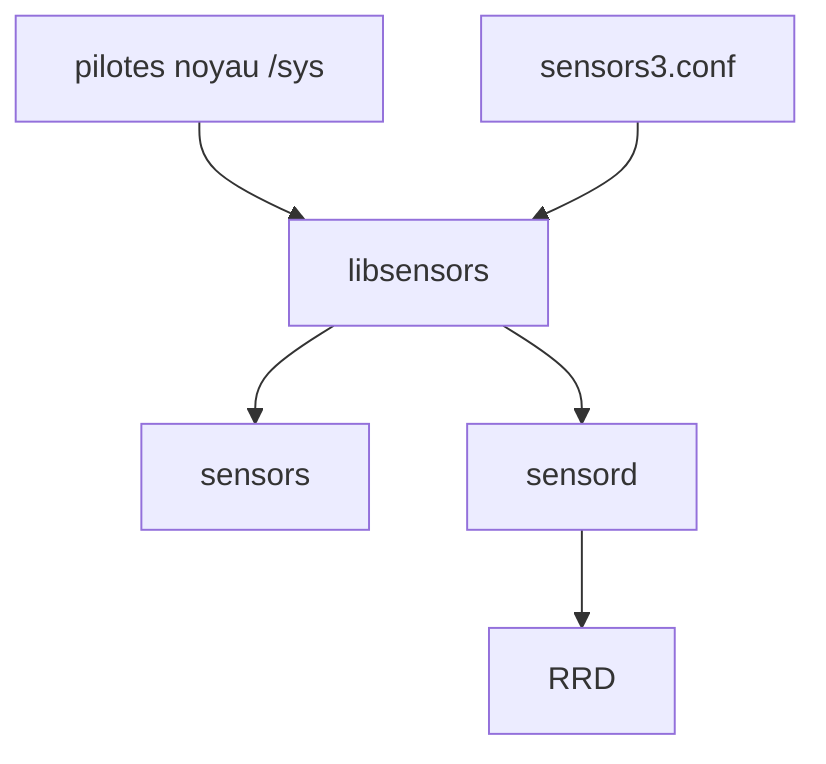

# lm-sensors/lm-sensors

> Linux library and tools to read temperatures, voltages and fans from hardware monitoring chips.

## The problem
The hwmon drivers expose raw values in `/sys`, poorly labeled and not scaled to the motherboard.

## What it actually does
`libsensors` reads sysfs and applies a configuration file (labels, conversions). Three programs: `sensors-detect` detects the hardware, `sensors` displays values and sets limits, `sensord` monitors and feeds an RRD database. Board configurations are provided.

## How it is wired


## Trying it
```bash
sensors-detect
sensors
```
Installation: see the INSTALL file.

## Cost and gotchas
Free. Linux 2.6.5 and later; version 2 is for older kernels. No graphical interface provided.

## What it is not
Not a graphical monitor (the README points to Psensor, s-tui, etc.). 267 open issues.

## Alternatives
- Psensor, GNOME Sensors Applet, PowerTOP, s-tui: cited in the README for a graphical or console interface.

## For you
Lowest priority, ignore: useful for monitoring the temperature of a training machine, but it is low-level and already present in distributions.
