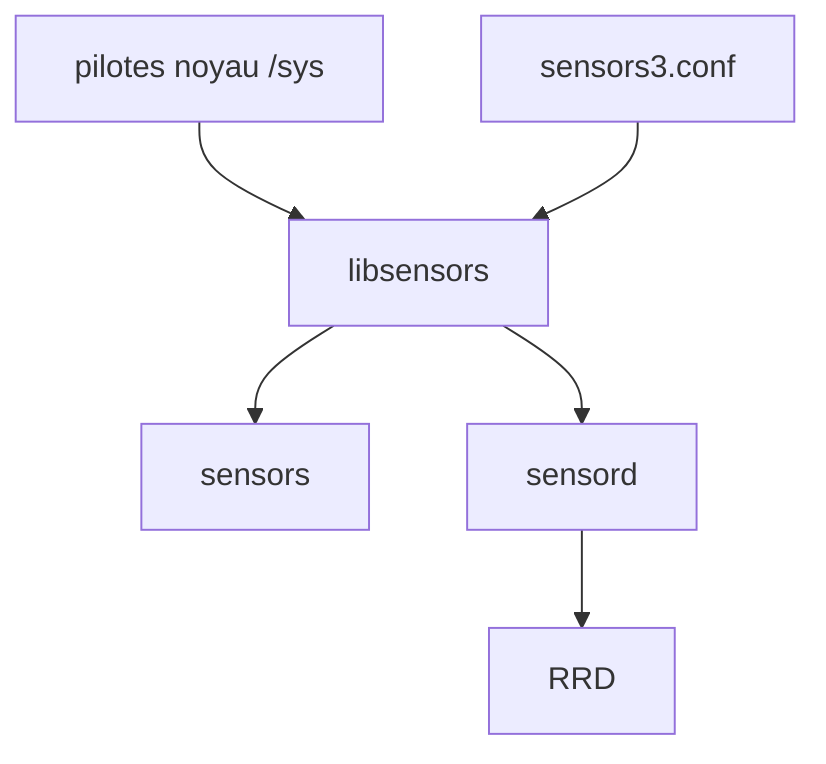

# lm-sensors/lm-sensors

> Bibliothèque et outils Linux pour lire températures, tensions et ventilateurs des puces de supervision matérielle.

## Le problème
Les pilotes hwmon exposent des valeurs brutes dans `/sys`, mal étiquetées et non mises à l'échelle selon la carte mère.

## Ce que ça fait vraiment
`libsensors` lit sysfs et applique un fichier de configuration (étiquettes, conversions). Trois programmes : `sensors-detect` détecte le matériel, `sensors` affiche et règle les limites, `sensord` surveille et alimente une base RRD. Des configurations de cartes sont fournies.

## Comment c'est branché


## Essayer
```bash
sensors-detect
sensors
```
Installation : voir le fichier INSTALL.

## Coût et pièges
Gratuit. Linux 2.6.5 et plus ; la version 2 sert aux noyaux plus anciens. Pas d'interface graphique fournie.

## Ce que ce n'est pas
Pas un moniteur graphique (le README renvoie vers Psensor, s-tui, etc.). 267 issues ouvertes.

## Alternatives
- Psensor, GNOME Sensors Applet, PowerTOP, s-tui : cités dans le README pour une interface graphique ou console.

## Pour toi
À ignorer en priorité : utile pour surveiller la température d'une machine d'entraînement, mais c'est du bas niveau déjà présent dans les distributions.

