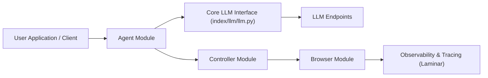

# lmnr-ai/index

> Python browser agent that performs web tasks with a vision LLM, as a library, CLI or API.

## The problem
Automating a site with no API: clicking, typing and extracting data in natural language.

## What it actually does
The `Agent` asks the LLM (Gemini, Claude, OpenAI) for an action; the controller translates it into Playwright/CDP commands; the browser module executes them. Structured output via Pydantic schema, interactive Textual CLI, local Chrome possible. Optional tracing to the Laminar platform, and a hosted serverless API.

## How it is wired


## Trying it
```bash
pip install lmnr-index 'lmnr[all]'
playwright install chromium
index run
```

## Cost and gotchas
LLM provider keys are at your expense; the serverless API and observability go through a Laminar account. Archived, last push in June 2025. The models cited (Gemini 2.5, Claude 3.7) are dated.

## What it is not
Not maintained: no more fixes expected. "State of the art" is the README's claim, not verified here.

## Alternatives
No alternative named in the README.

## For you
Ignore as a dependency: archived, with outdated models; read only for the agent/controller/browser architecture.
