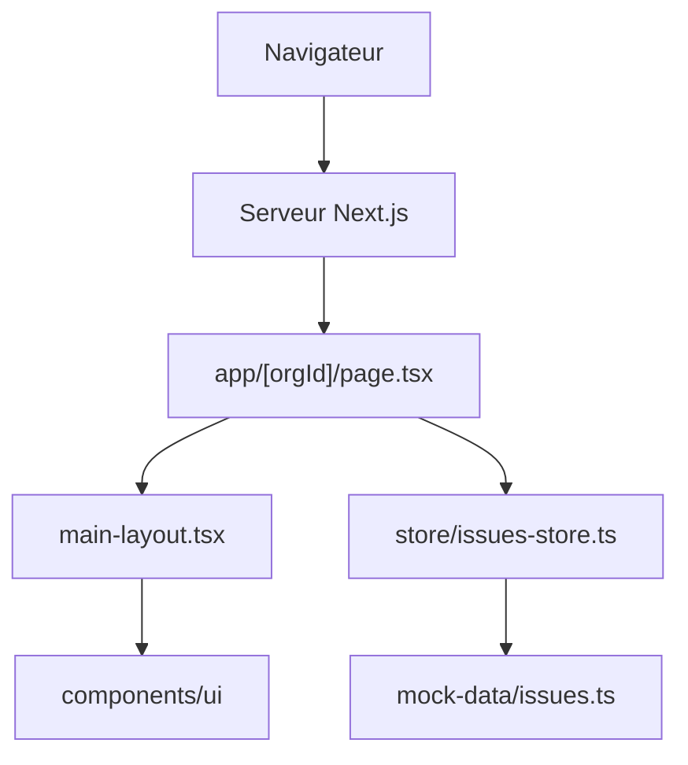

# ln-dev7/circle

> Mockup of a Linear-style project management interface, in Next.js and shadcn/ui.

## The problem
Having an example of a modern, responsive interface for tracking tickets, projects and teams.

## What it actually does
A Next.js application (TypeScript, Tailwind, shadcn/ui) with per-organization pages: tickets, projects, teams, members, settings. Based on the architecture, state lives in client-side stores and data comes from mock data modules, with no real backend.

## How it is wired


## Trying it
```bash
git clone https://github.com/ln-dev7/circle.git
cd circle
pnpm install
pnpm dev
```

## Cost and gotchas
Free. No backend: the data is fictitious, so nothing persists. Node and pnpm required.

## What it is not
Not a project management tool you can really use: it is a demo front end. The BaseUI version is sold separately.

## Alternatives
No alternative named in the README, which is inspired by Linear.

## For you
Ignore: a Next.js interface template, useful only for inspiration for a front end.
