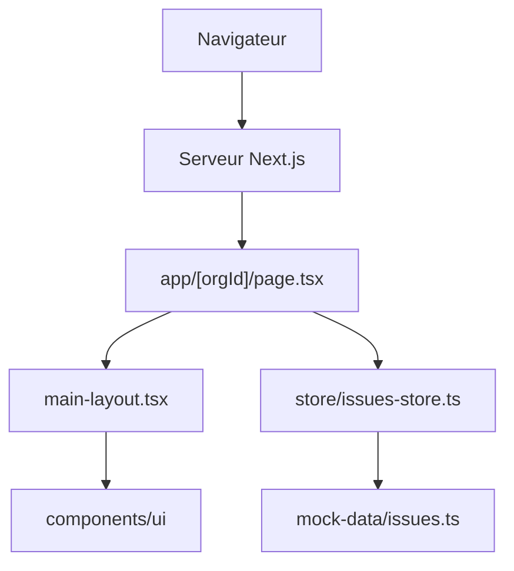

# ln-dev7/circle

> Maquette d'interface de gestion de projet à la Linear, en Next.js et shadcn/ui.

## Le problème
Avoir un exemple d'interface de suivi de tickets, projets et équipes moderne et réactive.

## Ce que ça fait vraiment
Application Next.js (TypeScript, Tailwind, shadcn/ui) avec pages par organisation : tickets, projets, équipes, membres, réglages. D'après l'architecture, l'état vit dans des stores côté client et les données viennent de modules de données factices, sans backend réel.

## Comment c'est branché


## Essayer
```bash
git clone https://github.com/ln-dev7/circle.git
cd circle
pnpm install
pnpm dev
```

## Coût et pièges
Gratuit. Aucun backend : les données sont fictives, donc rien ne persiste. Node et pnpm requis.

## Ce que ce n'est pas
Pas un outil de gestion de projet utilisable en vrai : c'est un front de démonstration. La version BaseUI est vendue à part.

## Alternatives
Aucune alternative nommée dans le README, qui s'inspire de Linear.

## Pour toi
Ignorer : un gabarit d'interface Next.js, utile seulement pour t'inspirer d'un front.

