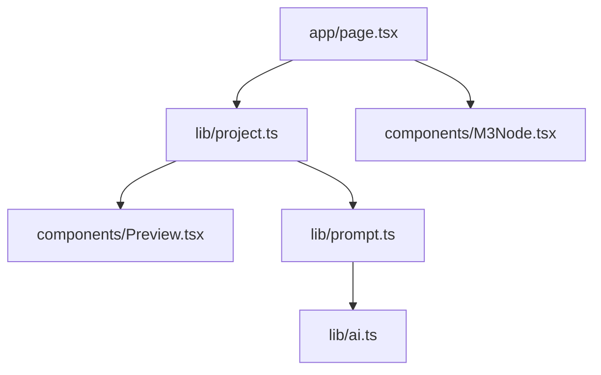

# lnkiai/m3e-canvas

> Web editor for sketching Material 3 Expressive screens and turning them into a prompt for an AI coding tool.

## The problem
Describing an interface to a coding assistant in text is imprecise; a structured sketch is needed.

## What it actually does
In the browser, you drag Material 3 components onto phone or desktop screens, link them and preview the navigation. The tool then generates a prompt (Japanese, English, Chinese, Korean) for Claude Code, Codex, Gemini CLI or Cursor. No server: the state stays in the browser.

## How it is wired


## Trying it
```bash
npm install
npm run dev        # http://localhost:3000
npm run build      # export statique vers ./out
```

## Cost and gotchas
Free. The optional AI help requires your own key (OpenAI, Claude, Gemini, DeepSeek), called directly from the browser. The full editor is desktop-only.

## What it is not
Not a code generator: it produces a prompt, not an application. Limited to Material 3.

## Alternatives
- matraic/m3e: Lit web components to build the sketched screens.
- Beer CSS: Material Design 3 CSS framework for the web version.

## For you
Ignore: an Android interface mockup tool, unrelated to data, AI or MLOps work.
