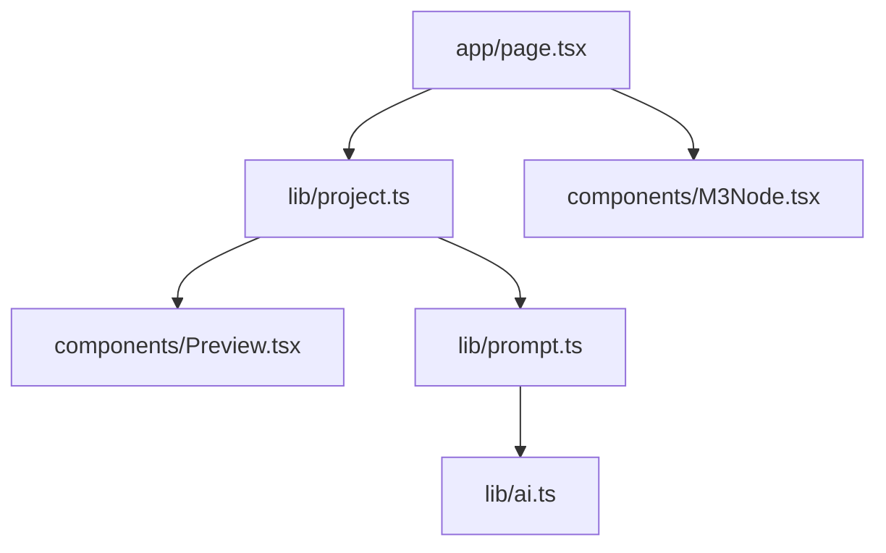

# lnkiai/m3e-canvas

> Éditeur web pour esquisser des écrans Material 3 Expressive et en tirer un prompt pour un outil de code IA.

## Le problème
Décrire une interface à un assistant de code en texte est imprécis ; il faut un croquis structuré.

## Ce que ça fait vraiment
Dans le navigateur, on glisse des composants Material 3 sur des écrans téléphone ou bureau, on les relie et on prévisualise la navigation. L'outil génère ensuite un prompt (japonais, anglais, chinois, coréen) pour Claude Code, Codex, Gemini CLI ou Cursor. Aucun serveur : l'état reste dans le navigateur.

## Comment c'est branché


## Essayer
```bash
npm install
npm run dev        # http://localhost:3000
npm run build      # export statique vers ./out
```

## Coût et pièges
Gratuit. L'aide IA optionnelle demande ta propre clé (OpenAI, Claude, Gemini, DeepSeek), appelée directement depuis le navigateur. Éditeur complet réservé au bureau.

## Ce que ce n'est pas
Pas un générateur de code : il produit un prompt, pas une application. Limité à Material 3.

## Alternatives
- matraic/m3e : composants Lit web pour construire les écrans esquissés.
- Beer CSS : framework CSS Material Design 3 pour la version web.

## Pour toi
À ignorer : outil de maquettage d'interfaces Android, sans lien avec un travail data, IA ou MLOps.

