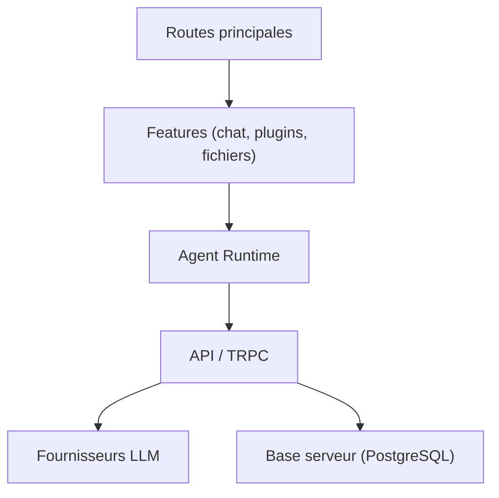

# lobehub/lobe-chat

> Platform for AI agents for teams, self-hosted, with an agent marketplace, MCP servers, and skills.

## The problem
To enable multiple agents to work together using team tools (chat, task management, knowledge base) without requiring them to set up the infrastructure themselves.

## What it actually does
Next.js application with agents, agent teams, scheduled tasks, memory, pages, a resource library, and communication channels (Discord, Slack, Telegram...). Over 40 model providers, with GitHub integration. A marketplace offers agents, MCP servers, and skills in the `SKILL.md` format. Self-hosting starts with PostgreSQL, Redis, RustFS storage, SearXNG, and the agent gateway.

## How it is wired


## Trying it
```bash
mkdir lobehub && cd lobehub
bash <(curl -fsSL https://lobe.li/setup.sh) -l en
docker compose up -d
```

## Cost and gotchas
Heavy self-hosting (PostgreSQL, Redis, object storage); Vercel also requires an S3-compatible database and storage. A cloud offering is available. The "LobeHub Community License" is not identified by GitHub: please read before commercial use.

## What it is not
Not under a standard open-source license. The README also displays an Apache 2.0 badge, which contradicts the "LobeHub Community License" mention: license to verify. This is not just a simple chat client; it is a complete platform.

## Alternatives
No alternative is specified in the README file.

## For you
Things to watch out for: It's a rich platform for team agents, but the infrastructure required to host it and the unclear licensing terms require careful consideration before adoption.
