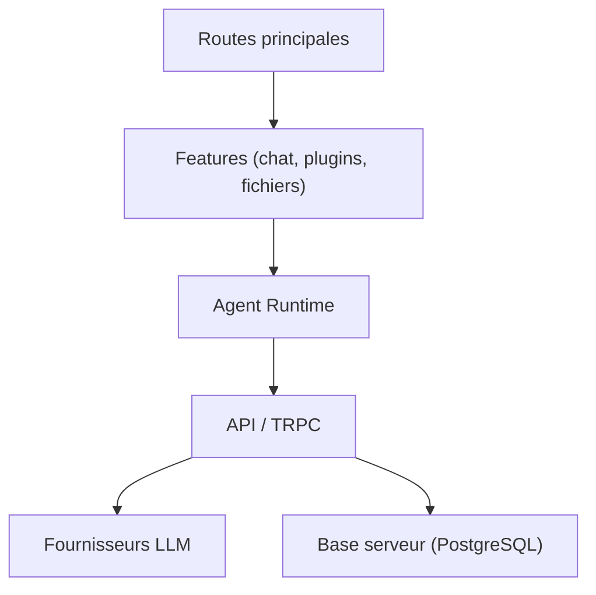

# lobehub/lobe-chat

> Plateforme d'agents IA pour équipes, auto-hébergeable, avec marketplace d'agents, serveurs MCP et skills.

## Le problème
Faire travailler plusieurs agents dans les outils d'équipe (chat, tâches, mémoire) sans assembler soi-même l'infrastructure.

## Ce que ça fait vraiment
Appli Next.js avec agents, équipes d'agents, tâches planifiées, mémoire, pages, bibliothèque de ressources, canaux (Discord, Slack, Telegram...), 40+ fournisseurs de modèles, intégration GitHub. Une marketplace propose agents, serveurs MCP et skills au format `SKILL.md`. L'auto-hébergement démarre PostgreSQL, Redis, stockage RustFS, SearXNG et la passerelle d'agents.

## Comment c'est branché


## Essayer
```bash
mkdir lobehub && cd lobehub
bash <(curl -fsSL https://lobe.li/setup.sh) -l en
docker compose up -d
```

## Coût et pièges
Auto-hébergement lourd (PostgreSQL, Redis, stockage objet) ; Vercel exige aussi une base et un stockage S3. Une offre Cloud existe. Licence « LobeHub Community License », non identifiée par GitHub : à lire avant usage commercial.

## Ce que ce n'est pas
Pas sous licence libre standard. Le README affiche aussi un badge Apache 2.0 qui contredit la mention « LobeHub Community License » : licence à vérifier. Pas un simple client de chat : c'est une plateforme complète.

## Alternatives
Aucune alternative nommée dans le README.

## Pour toi
À surveiller : riche pour une plateforme d'agents d'équipe, mais l'infra à héberger et la licence floue demandent un examen avant adoption.

