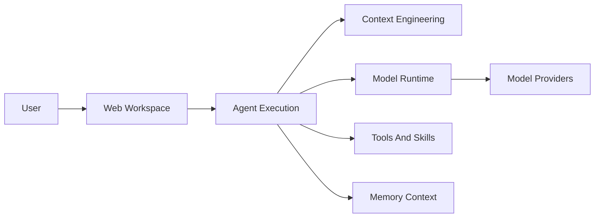

# lobehub/lobehub

> A workspace where a team of AI agents is formed, planned, and collaborates, and which can be self-hosted or accessed online.

## The problem
The current agents live in separate windows, without a shared context or useful memory, and require manual handovers between models.

## What it actually does
Combines chat, agents, agent groups, projects, scheduled tasks, and editable memory in a single web application. An Agent Builder configures an agent based on a description. The tools work with over 10,000 compatible MCP "skills" and plugins. An IM gateway connects agents to messaging systems. A command-line interface (CLI) and a desktop client are also available.

## How it is wired


## Trying it
```bash
mkdir lobehub-db && cd lobehub-db
bash <(curl -fsSL https://lobe.li/setup.sh)
docker compose up -d
```
Local development: `pnpm install` followed by `pnpm dev`.

## Cost and gotchas
An API key from a model provider is required (e.g., `OPENAI_API_KEY` in the example). The README refers to third-party proxies and disclaims any responsibility for the validity or security of their keys.

## What it is not
Not just a simple chat client: it's a complete platform to deploy and maintain. The license is contradictory: the text refers to a "LobeHub Community License," while a badge displays Apache 2.0, but GitHub does not recognize it.

## Alternatives
No alternative is specified in the README file.

## For you
Things to watch out for: Useful for coordinating team members, but the unclear license and the API key that you are responsible for require verification before use beyond a test.
