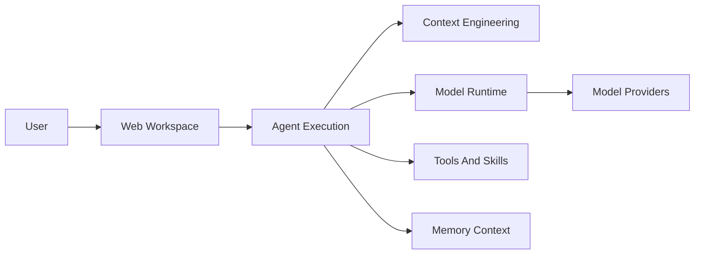

# lobehub/lobehub

> Espace de travail où une équipe d'agents IA se crée, se planifie et collabore, auto-hébergeable ou en ligne.

## Le problème
Les agents actuels vivent dans des fenêtres séparées, sans contexte partagé ni mémoire utile, et exigent des passages de relais manuels entre modèles.

## Ce que ça fait vraiment
Regroupe chat, agents, groupes d'agents, projets, tâches planifiées et mémoire éditable dans une seule application web. Un Agent Builder configure un agent à partir d'une description. Les outils passent par plus de 10 000 « skills » et plugins compatibles MCP. Une passerelle IM relie les agents aux messageries. Un CLI et un client desktop existent aussi.

## Comment c'est branché


## Essayer
```bash
mkdir lobehub-db && cd lobehub-db
bash <(curl -fsSL https://lobe.li/setup.sh)
docker compose up -d
```
Développement local : `pnpm install` puis `pnpm dev`.

## Coût et pièges
Une clé d'API de fournisseur de modèles est requise (`OPENAI_API_KEY` dans l'exemple). Le README renvoie vers des proxys tiers et décline toute responsabilité sur la validité ou la sécurité de leurs clés.

## Ce que ce n'est pas
Pas un simple client de chat : c'est une plateforme complète à déployer et à maintenir. La licence est contradictoire : le texte parle de « LobeHub Community License », un badge affiche Apache 2.0, GitHub ne la reconnaît pas.

## Alternatives
Aucune alternative nommée dans le README.

## Pour toi
À surveiller : utile pour orchestrer des agents en équipe, mais la licence floue et la clé d'API à ta charge demandent une vérification avant tout usage au-delà d'un test.

