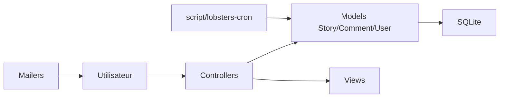

# lobsters/lobsters

> Rails code of the Lobsters news site, reusable to create a "sister" site.

## The problem
Launching a link-aggregation community with moderation and invitations, without starting from scratch.

## What it actually does
Rails application with SQLite in production. The README describes a deployment via Hatchbox (paid) on DigitalOcean: `solid_queue` process, cron jobs, Caddyfile, environment variables, creation of an admin user in the Rails console. Tags, moderation (`/mod`), mailers. The README warns that the hardest part is the community, not the code.

## How it is wired


## Trying it
```bash
echo "Test Postfix email, visit scnenic https://example.com" | mail -s "Postfix Test" test-whatever@srv1.mailtester.com
```
(Deployment via Hatchbox: detailed steps in the README; `rails credentials:edit`, `rails console`.)

## Cost and gotchas
Hatchbox is paid, DigitalOcean server, IP reputation management for e-mail. BSD 3-clause license stated in the README but not identified by GitHub.

## What it is not
Not a turnkey product nor supported for custom cases: the maintainers refuse features useful only to others.

## Alternatives
No alternative named in the README.

## For you
Ignore: community Rails application, no link to data/AI/MLOps.
