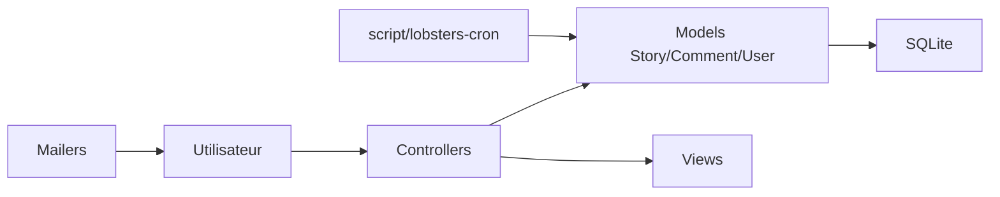

# lobsters/lobsters

> Code Rails du site d'actualités Lobsters, réutilisable pour créer un site « sœur ».

## Le problème
Lancer une communauté d'agrégation de liens avec modération et invitations, sans repartir de zéro.

## Ce que ça fait vraiment
Application Rails avec SQLite en production. Le README décrit un déploiement via Hatchbox (payant) sur DigitalOcean : processus `solid_queue`, tâches cron, Caddyfile, variables d'environnement, création d'un utilisateur admin en console Rails. Tags, modération (`/mod`), mailers. Le README prévient que le plus dur est la communauté, pas le code.

## Comment c'est branché


## Essayer
```bash
echo "Test Postfix email, visit scnenic https://example.com" | mail -s "Postfix Test" test-whatever@srv1.mailtester.com
```
(Déploiement via Hatchbox : étapes détaillées dans le README ; `rails credentials:edit`, `rails console`.)

## Coût et pièges
Hatchbox payant, serveur DigitalOcean, gestion de la réputation IP pour l'e-mail. Licence BSD 3-clauses annoncée dans le README mais non identifiée par GitHub.

## Ce que ce n'est pas
Pas un produit clé en main ni supporté pour des cas personnalisés : les mainteneurs refusent les fonctions utiles seulement à d'autres.

## Alternatives
Aucune alternative nommée dans le README.

## Pour toi
À ignorer : application Rails communautaire, aucun lien avec data/IA/MLOps.

