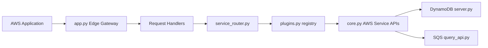

# localstack/localstack

> Local emulator of AWS services in a container, to develop and test without a cloud account.

## The problem
Testing an AWS app (Lambda, S3, DynamoDB, SQS) against the real cloud costs money, is slow, and requires accounts and permissions.

## What it actually does
A single container receives AWS requests from your SDK or `awslocal` on a gateway (`app.py`), parses and routes them (`service_router.py`) to an emulated service registered as a plugin (`plugins.py`), which returns a response serialized like AWS.
Services cited: Lambda, S3, DynamoDB, Kinesis, SQS, SNS, CloudFormation, Step Functions, OpenSearch, DNS, certificates. Driven by the `localstack` CLI (start, status); Docker, Compose or Helm.

## How it is wired


## Trying it
```bash
brew install localstack/tap/localstack-cli
python3 -m pip install localstack
localstack start -d
localstack status services
awslocal sqs create-queue --queue-name sample-queue
```

## Cost and gotchas
Docker required; do not run as root. The suite now ships as the unified image, free on the Hobby plan for non-commercial use; the Pro version adds APIs.

## What it is not
This repository is archived and read-only: it is no longer where LocalStack lives. Not complete AWS coverage: the list of supported APIs must be checked.

## Alternatives
- LocalStack for AWS (unified image) — the project's official suite, free Hobby plan excluding commercial use.

## For you
Ignore here; to emulate S3 or SQS in your MLOps tests, look at the unified image and its terms.
