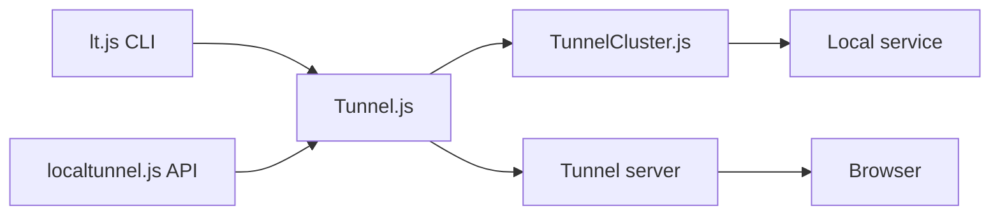

# localtunnel/localtunnel

> Exposes a local server on a public URL, for testing or receiving callbacks.

## The problem
To show a local site or receive an API webhook (e.g. Twilio), you need a public URL without touching DNS or deploying.

## What it actually does
The Node client asks the remote server (by default localtunnel.me) for a tunnel, opens transfer connections and relays traffic to the local port. A subdomain can be requested (not guaranteed), local HTTPS, Host rewriting. Usable as a CLI (`lt`) or as an API with request/error/close events.

## How it is wired


## Trying it
```bash
npx localtunnel --port 8000
npm install -g localtunnel
lt --port 8000
```

## Cost and gotchas
Free, but depends on the default public server; last push in August 2025, 167 open issues. A public URL exposes your local service to anyone who knows it.

## What it is not
Not a server: that one is a separate repository (localtunnel/server). The requested subdomain may not be assigned.

## Alternatives
Clients in other languages are cited: gotunnelme, go-localtunnel, localtunnel-client (.NET), rlt (Rust).

## For you
Handy for exposing a notebook or a demo API for an hour; few availability guarantees, not to be put in an MLOps flow.
