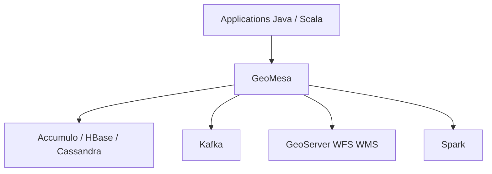

# locationtech/geomesa

> Scala/Java suite to query and analyze large volumes of geospatial data on Accumulo, HBase, Cassandra and Kafka.

## The problem
Distributed databases do not natively index time and space: querying billions of points, lines and polygons becomes slow.

## What it actually does
GeoMesa adds a spatio-temporal index on Accumulo, HBase and Cassandra, and a spatial layer on Kafka for near-real-time streams. It is exposed through GeoServer via WFS and WMS, and integrates with Spark for distributed analytics. Artifacts are on Maven Central, with `spark-runtime` JARs for Databricks. The version cited is 5.4.0.

## How it is wired
Simplified diagram based on the sheet, no diagram provided.



## Trying it
```bash
git clone git@github.com:locationtech/geomesa.git
cd geomesa
mvn clean install -Dmaven.test.skip
```

## Cost and gotchas
Long build, Java 25 and Maven 3.9.14 required, Docker for the tests. A distributed database must already be in place, and two third-party Maven repositories must be declared (osgeo, confluent).

## What it is not
Not a mapping application: an infrastructure library. Snapshot versions offer no compatibility guarantee.

## Alternatives
No alternative named in the README.

## For you
Worth watching: useful only if you handle massive spatio-temporal data on Hadoop or Kafka, otherwise it is too heavy.
