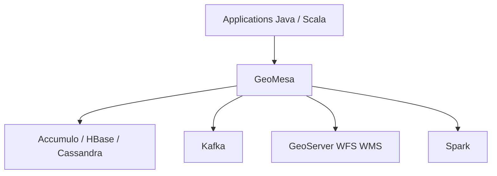

# locationtech/geomesa

> Suite Scala/Java pour interroger et analyser de grands volumes de données géospatiales sur Accumulo, HBase, Cassandra et Kafka.

## Le problème
Les bases distribuées n'indexent pas nativement le temps et l'espace : requêter des milliards de points, lignes et polygones devient lent.

## Ce que ça fait vraiment
GeoMesa ajoute un index spatio-temporel sur Accumulo, HBase et Cassandra, et une couche spatiale sur Kafka pour le flux quasi temps réel. Elle s'expose via GeoServer en WFS et WMS, et s'intègre à Spark pour les analyses distribuées. Les artefacts sont sur Maven Central, avec des JAR `spark-runtime` pour Databricks. La version citée est la 5.4.0.

## Comment c'est branché
Schéma simplifié d'après la fiche, sans diagramme fourni.



## Essayer
```bash
git clone git@github.com:locationtech/geomesa.git
cd geomesa
mvn clean install -Dmaven.test.skip
```

## Coût et pièges
Build long, Java 25 et Maven 3.9.14 requis, Docker pour les tests. Il faut une base distribuée déjà en place, et deux dépôts Maven tiers à déclarer (osgeo, confluent).

## Ce que ce n'est pas
Pas une application cartographique : une bibliothèque d'infrastructure. Les versions snapshot n'offrent aucune garantie de compatibilité.

## Alternatives
Aucune alternative nommée dans le README.

## Pour toi
À surveiller : utile seulement si tu manipules des données spatio-temporelles massives sur Hadoop ou Kafka, sinon c'est trop lourd.

