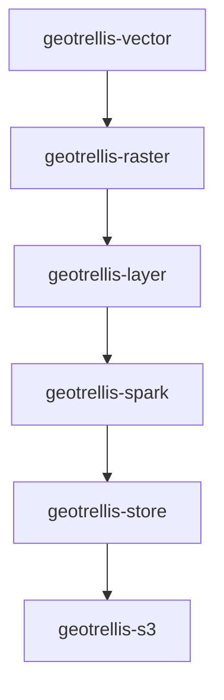

# locationtech/geotrellis

> Scala library to read, write and process raster and vector geospatial data, with Spark.

## The problem
Processing large volumes of rasters (satellite imagery, elevation models) requires distributable map algebra operations and storage connectors.

## What it actually does
Provides modules (`geotrellis-raster`, `vector`, `proj4`, `spark`, `store`, `gdal`, `s3`, Cassandra, HBase, Accumulo) to read and write rasters and vectors, compute MapAlgebra (for example a focal mean) and ingest at scale with Spark. Available for Scala 2.13 and 3, with Spark 4.2.x.

## How it is wired
Simplified diagram based on the sheet, no diagram provided.


## Trying it
```scala
libraryDependencies += "org.locationtech.geotrellis" %% "geotrellis-raster" % "<latest version>"
```

## Cost and gotchas
Free. SBT and the JVM are required (not listed in the prerequisites). The README declares Apache 2, but GitHub does not identify the license: to be verified. 242 open issues.

## What it is not
Not a desktop GIS nor a Python library. The vector tile modules are experimental.

## Alternatives
No alternative named in the README.

## For you
Worth watching: relevant if you do large-scale raster analysis on Spark in Scala, otherwise a detour.
