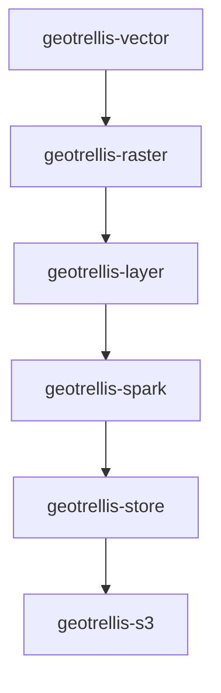

# locationtech/geotrellis

> Bibliothèque Scala pour lire, écrire et traiter des données géospatiales raster et vectorielles, avec Spark.

## Le problème
Traiter de grands volumes de rasters (images satellite, modèles d'altitude) demande des opérations de carte algébrique distribuables et des connecteurs de stockage.

## Ce que ça fait vraiment
Fournit des modules (`geotrellis-raster`, `vector`, `proj4`, `spark`, `store`, `gdal`, `s3`, Cassandra, HBase, Accumulo) pour lire et écrire des rasters et vecteurs, calculer de la MapAlgebra (par exemple une moyenne focale) et ingérer à l'échelle avec Spark. Disponible pour Scala 2.13 et 3, avec Spark 4.2.x.

## Comment c'est branché
Schéma simplifié d'après la fiche, sans diagramme fourni.


## Essayer
```scala
libraryDependencies += "org.locationtech.geotrellis" %% "geotrellis-raster" % "<latest version>"
```

## Coût et pièges
Gratuit. Il faut SBT et la JVM (non listés dans les prérequis). Le README déclare Apache 2, mais GitHub n'identifie pas la licence : à vérifier. 242 issues ouvertes.

## Ce que ce n'est pas
Pas un SIG de bureau ni une bibliothèque Python. Les modules vectoriels de tuiles sont expérimentaux.

## Alternatives
Aucune alternative nommée dans le README.

## Pour toi
Surveiller : pertinent si tu fais de l'analyse raster à grande échelle sur Spark en Scala, sinon un détour.

