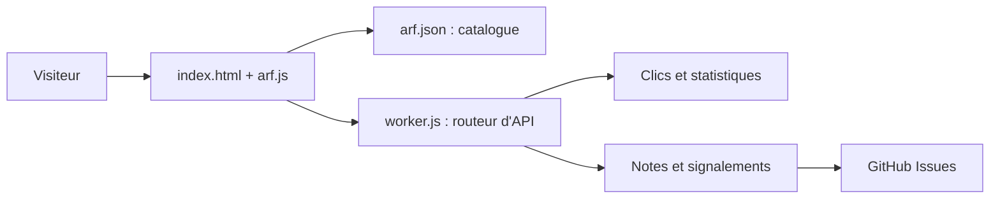

# lockfale/OSINT-Framework

> Web directory of free OSINT tools, sorted by category, for information research.

## The problem
Open-source intelligence resources are scattered, and you don't know which ones are free.

## What it actually does
A tree of resources (`arf.json`) displayed on osintframework.com, with markers: (T) local tool, (D) Google Dork, (R) registration, (M) URL to edit. Each entry can carry metadata (status, pricing, input, output, passive/active discretion). A Cloudflare Worker records clicks, ratings and reports, and can create GitHub issues.

## How it is wired

## Trying it
No installation command: open https://osintframework.com. To contribute, add an entry to `arf.json` then open a PR.

## Cost and gotchas
Free; some listed sites require registration or are paid beyond a threshold. The site collects clicks and ratings through a Worker.

## What it is not
It is not an investigation tool: it is a directory of links, whose freshness depends on the statuses filled in.

## Alternatives
- No alternative named in the README.

## For you
Worth watching: a good entry point to find open data sources, but it is only a directory of links.
