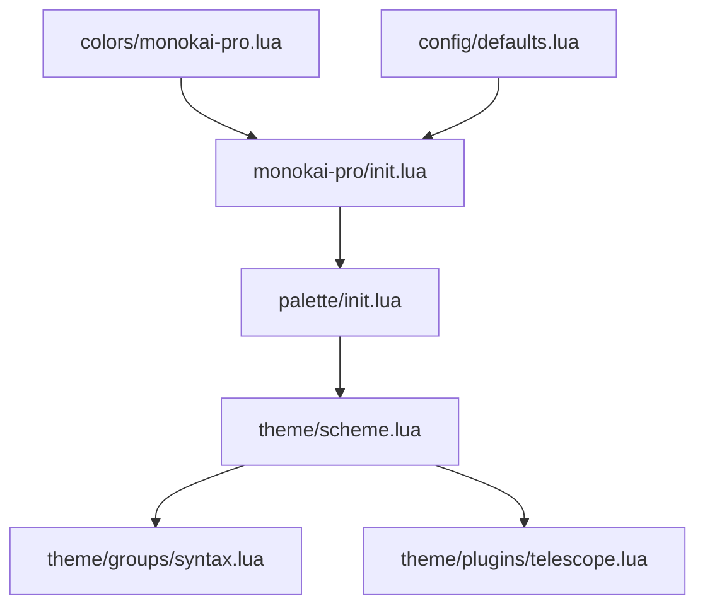

# loctvl842/monokai-pro.nvim

> Monokai Pro color theme for Neovim, with six filters and lazy loading.

## The problem
Get the Monokai Pro look in Neovim, down to the plugins.

## What it actually does
Provides the Pro, Octagon, Machine, Ristretto, Spectrum and Classic filters. A palette builds a scheme, from which syntax and plugin groups are derived, applied lazily by event or module. Integrations: lualine, barbecue, lightline and NvChad. Version 2.0.0 announces a rewrite with possible regressions.

## How it is wired


## Trying it
```bash
# Dans lazy.nvim :
# require("monokai-pro").setup()
# vim.cmd.colorscheme("monokai-pro")
# :MonokaiPro spectrum
```

## Cost and gotchas
Free. The `:MonokaiPro` selector requires nui.nvim. Possible regressions after the 2.0.0 rewrite.

## What it is not
Not an officially validated Monokai theme: the README mentions no link with the original editor.

## Alternatives
No alternative named in the README.

## For you
Pure editor cosmetics, unrelated to data / AI: ignore.
