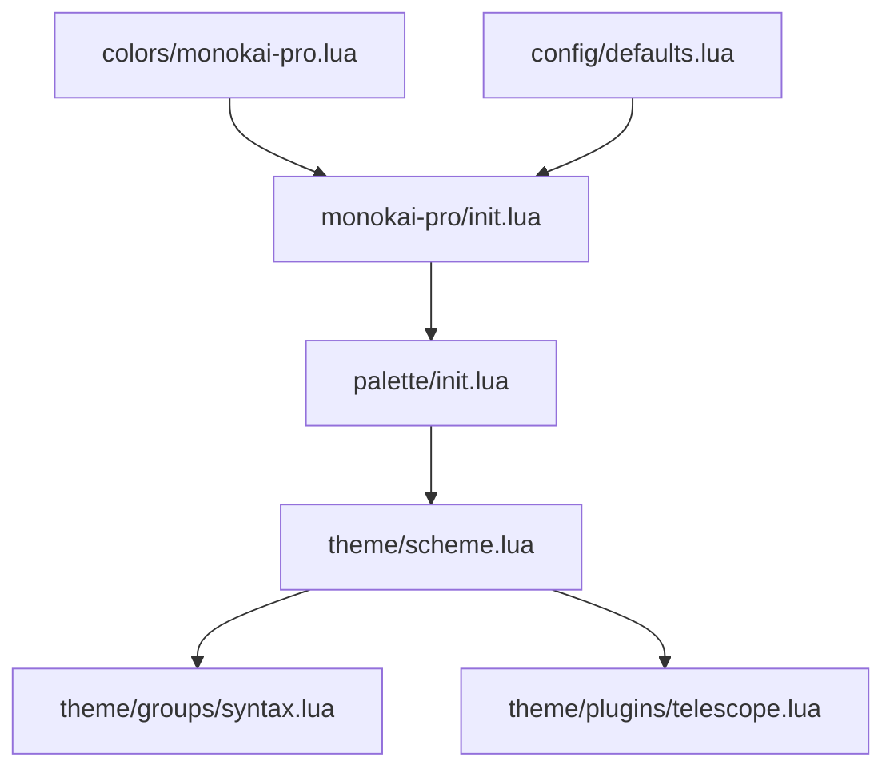

# loctvl842/monokai-pro.nvim

> Thème de couleurs Monokai Pro pour Neovim, avec six filtres et un chargement paresseux.

## Le problème
Retrouver l'apparence de Monokai Pro dans Neovim, jusque dans les plugins.

## Ce que ça fait vraiment
Fournit les filtres Pro, Octagon, Machine, Ristretto, Spectrum et Classic. Une palette construit un schéma, d'où dérivent les groupes de syntaxe et ceux des plugins, appliqués paresseusement par événement ou module. Intégrations lualine, barbecue, lightline et NvChad. La version 2.0.0 annonce une refonte avec régressions possibles.

## Comment c'est branché


## Essayer
```bash
# Dans lazy.nvim :
# require("monokai-pro").setup()
# vim.cmd.colorscheme("monokai-pro")
# :MonokaiPro spectrum
```

## Coût et pièges
Gratuit. Le sélecteur `:MonokaiPro` demande nui.nvim. Régressions possibles après la refonte 2.0.0.

## Ce que ce n'est pas
Pas un thème Monokai officiel validé : le README ne parle d'aucun lien avec l'éditeur d'origine.

## Alternatives
Aucune alternative nommée dans le README.

## Pour toi
Pure cosmétique d'éditeur, sans lien avec la data / IA : à ignorer.

