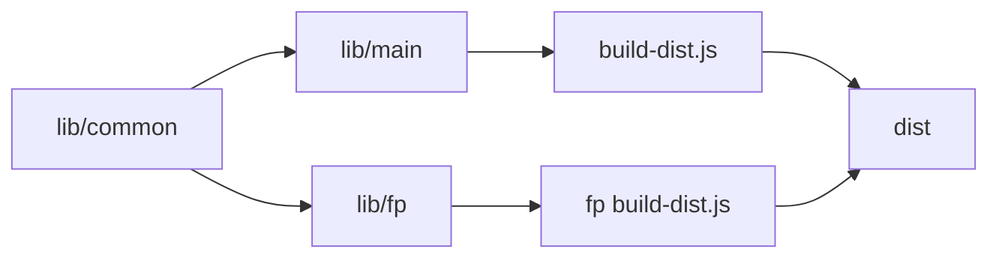

# lodash/lodash

> JavaScript utility library for arrays, objects and functions, for front-end or Node developers.

## The problem
Manipulating arrays, objects, strings and functions in JavaScript requires a lot of repetitive code.

## What it actually does
Lodash offers modular methods (iteration, value testing, function composition) in several builds: full (~24 kB compressed), core (~4 kB), FP (curried functions), `lodash-es` and AMD. The repository builds these variants via `lodash-cli`. The README announces a move to "feature-complete" maturity under the OpenJS Foundation, with a technical committee being reorganized.

## How it is wired


## Trying it
```bash
npm i --save lodash
```
```js
var _ = require('lodash');
var fp = require('lodash/fp');
var at = require('lodash/at');
```

## Cost and gotchas
Free. License present but not identified by GitHub; the README says MIT. Inconsistent versions between the README (4.18.1) and the architecture analysis (4.17.21): to be verified.

## What it is not
Not a data computation library: it is general-purpose JavaScript.

## Alternatives
No alternative named in the README.

## For you
Ignore: general-purpose JavaScript tool, outside the Python data and AI stack.
