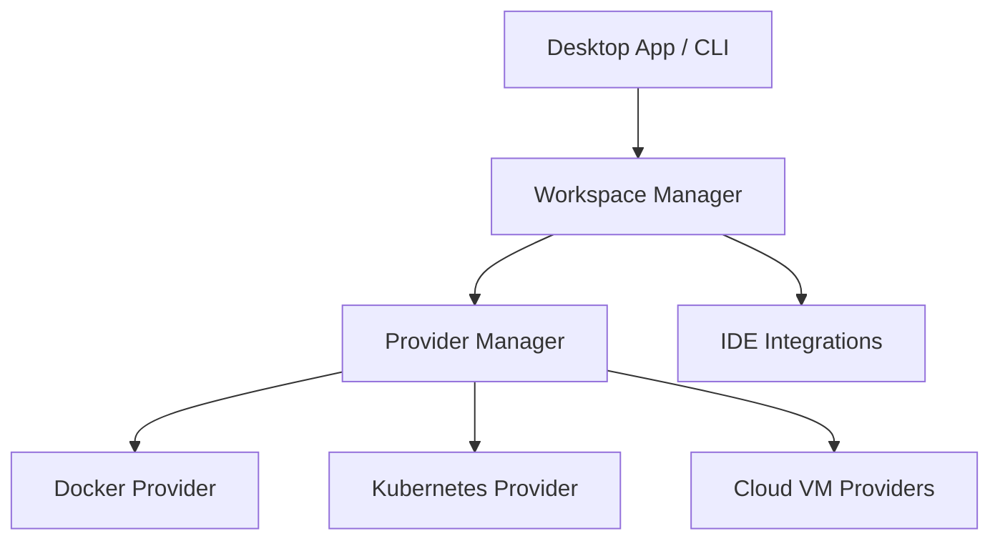

# loft-sh/devpod

> Reproducible dev environments built from a devcontainer, on any backend, with no server.

## The problem
Codespaces and equivalent services are expensive and lock you in with a vendor. Setting up development VMs by hand takes time.

## What it actually does
It reuses the DevContainer standard and creates the environment locally (Docker), on Kubernetes or on a cloud VM.
Everything runs client-side only: idle VMs shut down automatically, with Git and Docker credential syncing and prebuilds.
It supports VSCode, JetBrains and SSH, with a desktop app and a CLI.
Providers are extensible, and you can write your own.

## How it is wired

## Trying it
The README gives no command: only links to the desktop app (macOS, Windows, AppImage).

## Cost and gotchas
The tool is free. Cloud VMs are billed by your provider.

## What it is not
It is not a hosted service. The README is short and the diagram is generic. Last push on 2025-11-14.

## Alternatives
The README names GitHub Codespaces, JetBrains Spaces and Google Cloud Workstations as comparable hosted services, but no repositories.

## For you
Worth watching: handy for spinning up disposable GPU environments on demand with a devcontainer, but activity is slowing down.
