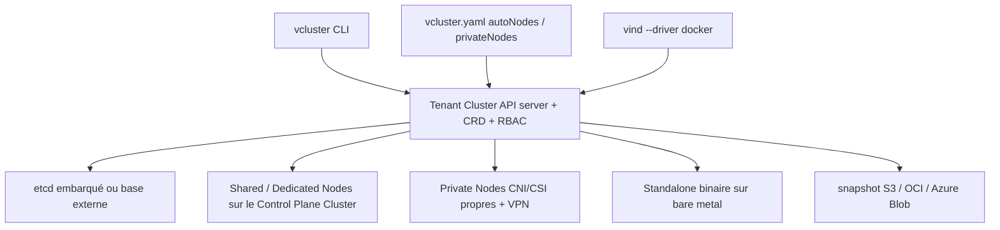

# loft-sh/vcluster

> Isolated virtual Kubernetes clusters, with their own API server, for multi-tenant and GPU platforms.

## The problem
Isolating teams by namespace leaves a shared control plane: no CRDs of their own, no RBAC of their own, lateral paths possible.
Giving each team a real cluster multiplies infrastructure and cost.

## What it actually does
Creates Tenant Clusters: each has its own API server, CRDs, RBAC and datastore (embedded etcd or external database PostgreSQL/MySQL/RDS).
Four architectures: Shared Nodes (density), Dedicated Nodes (labeled node pools), Private Nodes v0.27+ (own CNI/CSI, token-based joining, encrypted VPN v0.30+), Standalone v0.29+ (standalone binary, no control cluster).
Auto Nodes v0.28+ provisions private nodes via Karpenter; vind v0.32+ runs a full cluster inside Docker.
Snapshot and restore to S3, OCI, Azure Blob or local storage; DRA for GPUs; bidirectional resource sync in Shared/Dedicated modes.

## How it is wired


## Trying it
```bash
brew install loft-sh/tap/vcluster
vcluster create my-vcluster --namespace team-x
kubectl get namespaces
vcluster create my-vcluster --driver docker
```

## Cost and gotchas
This repository is the open engine; sleep mode, node VPN, UI and the Slurm/Ray/Run:ai/inference types go through vCluster Platform. A free tier is announced up to 64 CPUs and 32 GPUs.
Scoping pitfall: the sync features and reuse of the platform stack only apply in Shared and Dedicated modes, not in Private Nodes or Standalone.

## What it is not
Not a namespace with rules on top: the README insists on the dedicated API server.
Not a single distribution: behavior changes a lot depending on the chosen architecture.
Not the whole product — vNode, vMetal and the Netris integration are other paid components.

## Alternatives
No named alternative; the cited projects (Karpenter, kind, Argo, Crossplane) are components or integrations.

## For you
Relevant if you must split a GPU fleet between teams; otherwise a well-tuned namespace is enough.
