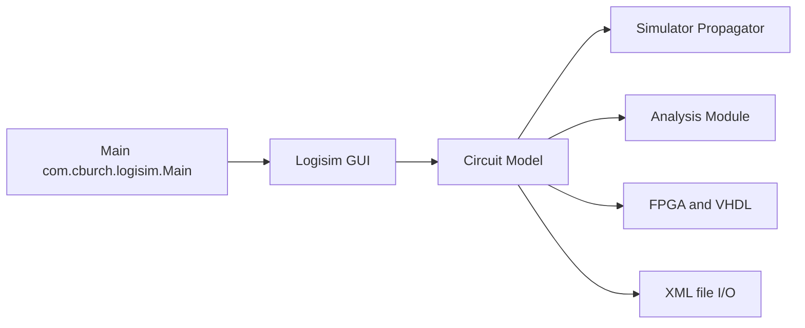

# logisim-evolution/logisim-evolution

> Educational Java software for designing and simulating digital logic circuits.

## The problem
Learning or checking a logic circuit without hardware or FPGA boards at hand.

## What it actually does
Swing application: you place gates, inputs and probes on a canvas, run the simulation, and watch a timing diagram. VHDL components, TCL console, FPGA board integration, analysis module (truth tables, Karnaugh maps). `.circ` files in XML.

## How it is wired


## Trying it
```bash
env _JAVA_AWT_WM_NONREPARENTING=1 java -jar logisim-evolution-<version>-all.jar
```
.deb, .rpm, .msi, .dmg and Snap packages available; Java 21 for the JAR.

## Cost and gotchas
Free. The macOS app is unsigned: manual workaround needed. An empty window is possible under some Linux window managers.

## What it is not
Not an industrial synthesis tool nor a full HDL simulator.

## Alternatives
No alternative named in the README.

## For you
Ignore: an electronics teaching tool, unrelated to your work.
