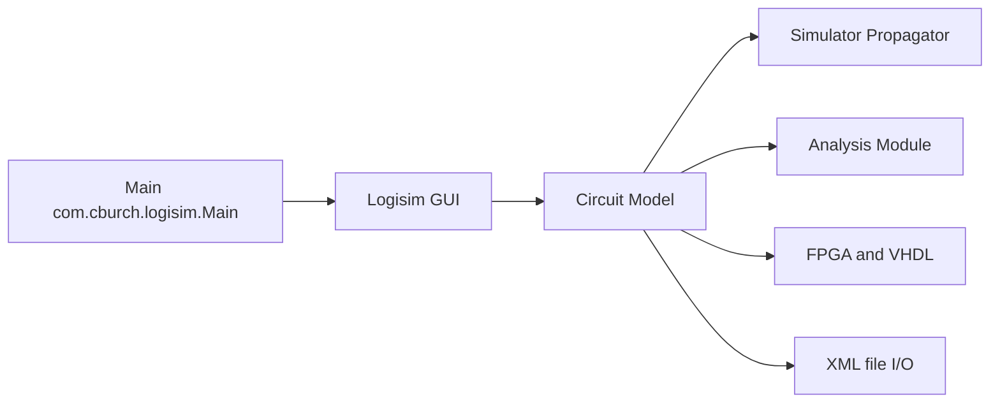

# logisim-evolution/logisim-evolution

> Logiciel pédagogique Java de conception et simulation de circuits logiques numériques.

## Le problème
Apprendre ou vérifier un circuit logique sans matériel ni cartes FPGA sous la main.

## Ce que ça fait vraiment
Application Swing : on place portes, entrées et sondes sur un canvas, on simule, on observe un chronogramme. Composants VHDL, console TCL, intégration de cartes FPGA, module d'analyse (tables de vérité, Karnaugh). Fichiers `.circ` en XML.

## Comment c'est branché


## Essayer
```bash
env _JAVA_AWT_WM_NONREPARENTING=1 java -jar logisim-evolution-<version>-all.jar
```
Paquets .deb, .rpm, .msi, .dmg et Snap disponibles ; Java 21 pour le JAR.

## Coût et pièges
Gratuit. Application macOS non signée : contournement manuel. Fenêtre vide possible sous certains gestionnaires Linux.

## Ce que ce n'est pas
Pas un outil de synthèse industriel ni un simulateur HDL complet.

## Alternatives
Aucune alternative nommée dans le README.

## Pour toi
À ignorer : outil d'enseignement de l'électronique, sans rapport avec ton métier.

