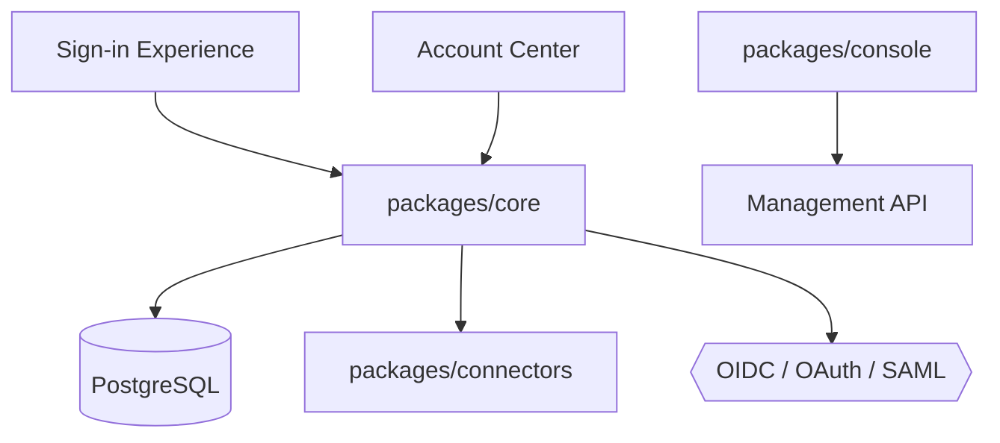

# logto-io/logto

> Open-source authentication infrastructure (OIDC, OAuth 2.1, SAML) for SaaS and AI applications.

## The problem
Building multi-tenant authentication with enterprise SSO and RBAC is slow and risky.

## What it actually does
A Core server handles sign-in flows, MFA and profile, with PostgreSQL persistence. Connectors add social logins, enterprise SSO, email and SMS. A console and a management API configure tenants, organizations and roles. SDKs for more than thirty frameworks, MCP and agent support announced.

## How it is wired


## Trying it
```bash
curl -fsSL https://raw.githubusercontent.com/logto-io/logto/HEAD/docker-compose.yml | \
docker compose -p logto -f - up
npm init @logto
```

## Cost and gotchas
Self-hosting: Docker and PostgreSQL. Logto Cloud is the managed offering. Email and SMS connectors go through third-party providers that you must configure.

## What it is not
Not a simple library: it is a service to operate. MPL-2.0 license, per-file copyleft; the README does not detail its implications.

## Alternatives
No alternative named in the README.

## For you
Worth watching: useful to secure an exposed service or inference API with SSO and roles, at the price of one more service.
