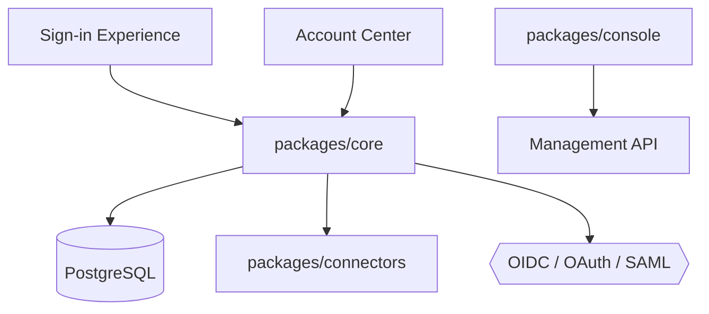

# logto-io/logto

> Infrastructure d'authentification open source (OIDC, OAuth 2.1, SAML) pour applications SaaS et IA.

## Le problème
Construire une authentification multi-tenant avec SSO d'entreprise et RBAC est long et risqué.

## Ce que ça fait vraiment
Un serveur Core gère les parcours de connexion, MFA et profil, avec persistance PostgreSQL. Des connecteurs ajoutent réseaux sociaux, SSO d'entreprise, e-mail et SMS. Une console et une API de gestion configurent tenants, organisations et rôles. SDK pour plus de trente frameworks, prise en charge de MCP et agents annoncée.

## Comment c'est branché


## Essayer
```bash
curl -fsSL https://raw.githubusercontent.com/logto-io/logto/HEAD/docker-compose.yml | \
docker compose -p logto -f - up
npm init @logto
```

## Coût et pièges
Auto-hébergement : Docker et PostgreSQL. Logto Cloud est l'offre gérée. Les connecteurs e-mail et SMS passent par des fournisseurs tiers à configurer.

## Ce que ce n'est pas
Pas une simple bibliothèque : c'est un service à exploiter. Licence MPL-2.0, copyleft par fichier ; le README ne détaille pas ses implications.

## Alternatives
Aucune alternative nommée dans le README.

## Pour toi
À surveiller : utile pour sécuriser un service ou une API d'inférence exposés avec SSO et rôles, au prix d'un service de plus.

