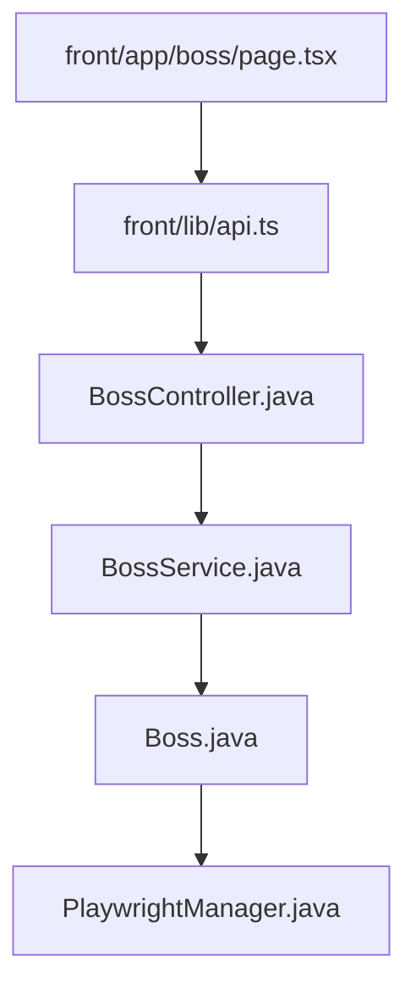

# loks666/get_jobs

> Automates job applications and outreach messages on the Chinese job platforms Boss and Liepin.

## The problem
Applying in bulk on Chinese job platforms is repetitive and time-consuming.

## What it actually does
Drives a browser (Playwright) to contact recruiters, filters out inactive HR staff and headhunters, writes AI-personalized messages and sends an image CV. Notifications via WeChat Work, automatic company blacklist. Next.js web interface on top of a Spring backend. Only Boss and Liepin are maintained.

## How it is wired


## Trying it
```bash
git clone https://github.com/loks666/get_jobs.git
cd get_jobs
# renommer getjobs.db.template en getjobs.db, le placer dans db/
# lancer GetJobsApplication.java
```

## Cost and gotchas
Gradle and JDK 21 required (not listed in the standard prerequisites), database to download from the releases. AI calls are at your expense (about $0.06 per day according to the author). No server deployment possible. PolyForm Noncommercial license: commercial use forbidden.

## What it is not
Not a job-search aid outside China, and the repository accepts no PR without prior agreement. The risk of account blocking by the platforms is not documented.

## Alternatives
No alternative named in the README.

## For you
Ignore: a tool centered on Chinese platforms, under a non-commercial license, unrelated to data or MLOps work.
