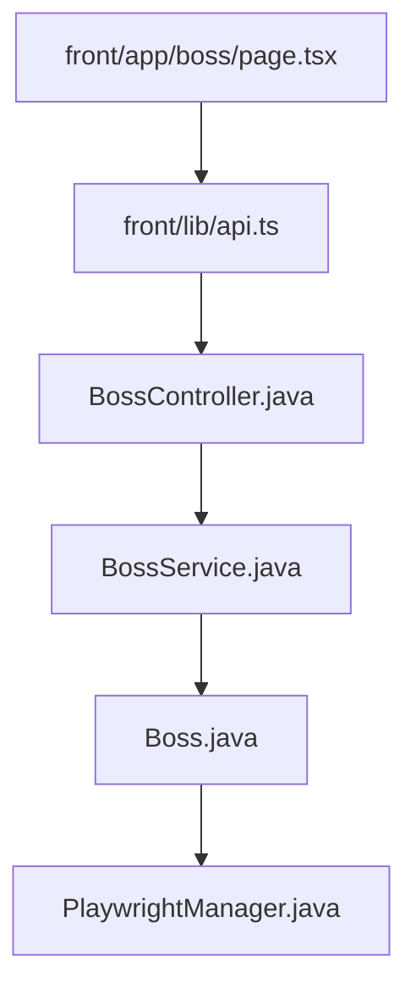

# loks666/get_jobs

> Automatise les candidatures et messages d'accroche sur les plateformes d'emploi chinoises Boss et Liepin.

## Le problème
Postuler en masse sur des plateformes d'emploi chinoises est répétitif et chronophage.

## Ce que ça fait vraiment
Pilote un navigateur (Playwright) pour contacter des recruteurs, filtre les RH inactifs et les chasseurs de têtes, écrit des messages personnalisés par IA et envoie un CV image. Notifications via WeChat Work, liste noire d'entreprises automatique. Interface web Next.js au-dessus d'un backend Spring. Seuls Boss et Liepin sont maintenus.

## Comment c'est branché


## Essayer
```bash
git clone https://github.com/loks666/get_jobs.git
cd get_jobs
# renommer getjobs.db.template en getjobs.db, le placer dans db/
# lancer GetJobsApplication.java
```

## Coût et pièges
Gradle et JDK 21 requis (non listés dans les prérequis standard), base à télécharger depuis les releases. Les appels IA sont à ta charge (environ 0,06 $ par jour d'après l'auteur). Pas de déploiement serveur possible. Licence PolyForm Noncommercial : usage commercial interdit.

## Ce que ce n'est pas
Pas une aide à la recherche d'emploi hors Chine, et le dépôt n'accepte aucune PR sans accord préalable. Le risque de blocage de compte par les plateformes n'est pas documenté.

## Alternatives
Aucune alternative nommée dans le README.

## Pour toi
À ignorer : outil centré sur des plateformes chinoises, sous licence non commerciale, sans rapport avec un travail data ou MLOps.

