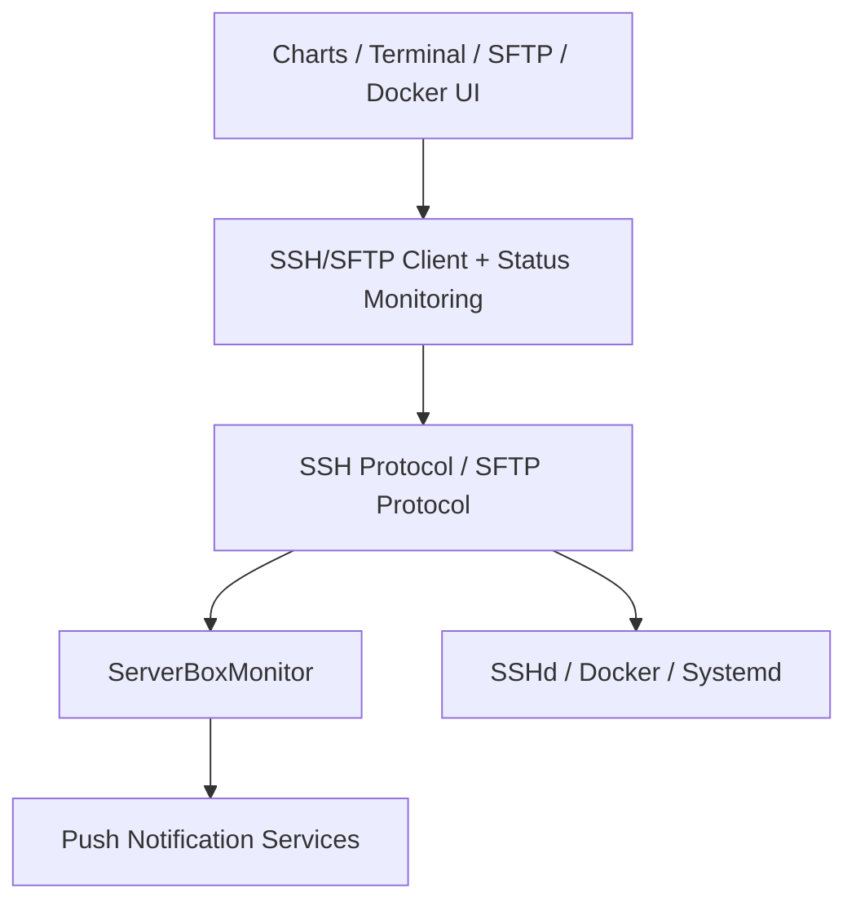

# lollipopkit/flutter_server_box

> Mobile and desktop app for monitoring and administering Linux, Unix and Windows servers.

## The problem
Checking a server's state or acting on it from a phone requires an SSH client, a metrics terminal and several separate tools.

## What it actually does
Displays CPU, memory, disk, network, sensor and GPU (NVIDIA, AMD) charts. Offers an SSH terminal, an SFTP browser, management of Docker/Podman, systemd, firewall, libvirt VMs and Proxmox. An optional agent (Monitor) enables push alerts, widgets and watchOS watch support. An AI agent and three skills are provided.

## How it is wired


## Trying it
```bash
brew install --cask server-box          # macOS
npx skills add lollipopkit/flutter_server_box
```
Other platforms: download from the App Store, GitHub or F-Droid.

## Cost and gotchas
Free. The Monitor agent is required for notifications, widgets and the watch. The GitHub iOS builds are unsigned. AGPL-3.0 license with CLA.

## What it is not
Not a server monitoring platform: it is a personal client. It does not replace Prometheus nor a team alerting system.

## Alternatives
No alternative named in the README.

## For you
Worth watching: handy for a quick look at the GPUs and containers of a training server from a phone, no value for a pipeline.
