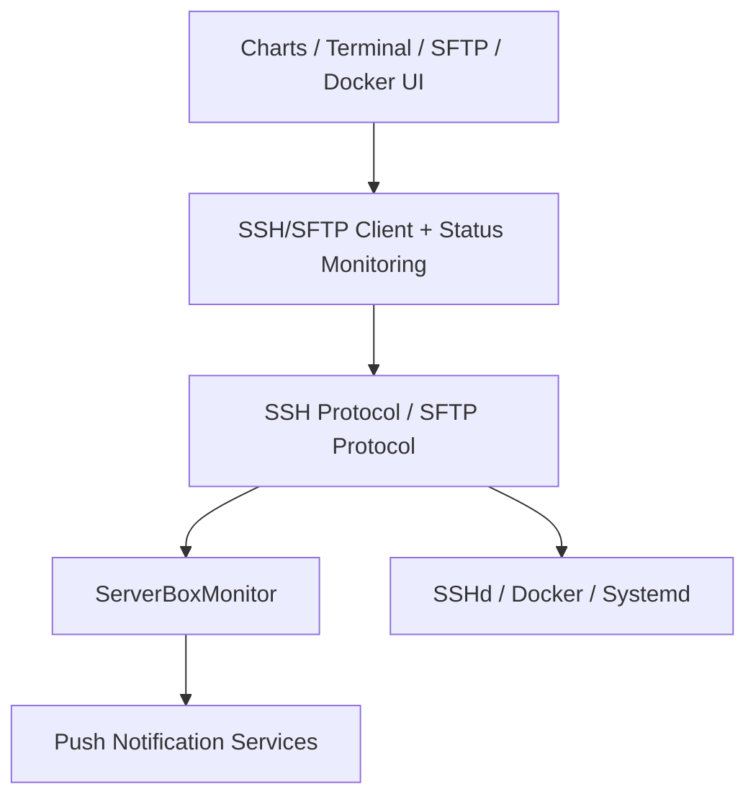

# lollipopkit/flutter_server_box

> Application mobile et bureau pour surveiller et administrer des serveurs Linux, Unix et Windows.

## Le problème
Vérifier l'état d'un serveur ou y intervenir depuis un téléphone demande un client SSH, un terminal de métriques et plusieurs outils séparés.

## Ce que ça fait vraiment
Affiche des graphiques CPU, mémoire, disques, réseau, capteurs et GPU (NVIDIA, AMD). Offre un terminal SSH, un navigateur SFTP, la gestion de Docker/Podman, systemd, pare-feu, VM libvirt et Proxmox. Un agent optionnel (Monitor) active alertes push, widgets et montre watchOS. Un agent IA et trois skills sont fournis.

## Comment c'est branché


## Essayer
```bash
brew install --cask server-box          # macOS
npx skills add lollipopkit/flutter_server_box
```
Autres plateformes : téléchargement depuis App Store, GitHub ou F-Droid.

## Coût et pièges
Gratuit. L'agent Monitor est requis pour les notifications, widgets et la montre. Les builds iOS GitHub ne sont pas signés. Licence AGPL-3.0 avec CLA.

## Ce que ce n'est pas
Pas une plateforme de supervision serveur : c'est un client personnel. Ne remplace pas Prometheus ni une alerte d'équipe.

## Alternatives
Aucune alternative nommée dans le README.

## Pour toi
À surveiller : pratique pour jeter un œil aux GPU et conteneurs d'un serveur d'entraînement depuis un téléphone, sans valeur pour un pipeline.

