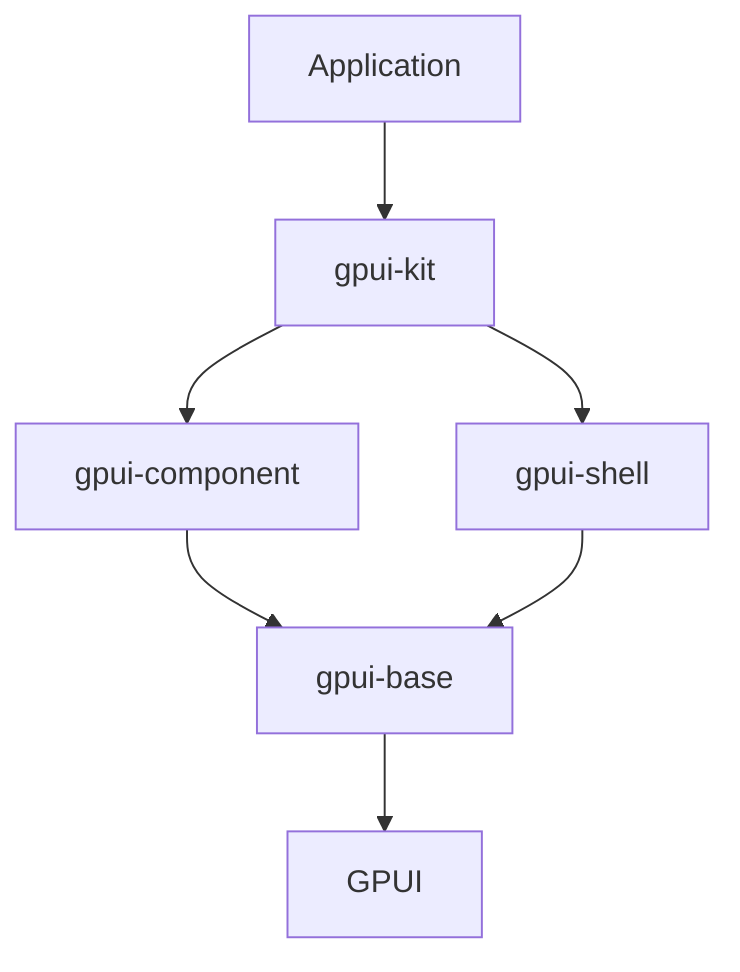

# longbridge/gpui-component

> Rust desktop application framework on GPUI, with more than 75 components, for native app developers.

## The problem
Building a performant desktop interface in Rust without rewriting tables, editor, docks.

## What it actually does
`gpui-kit` bundles `gpui-base` (unstyled behavior), `gpui-component` (styled components: virtual tables, code editor, dock, Markdown/HTML, charts) and `gpui-shell` (JavaScript extensions). WebAssembly support, AccessKit, headless integration tests. Derived from the commercial application Longbridge Pro. The README also describes skills for coding agents.

## How it is wired


## Trying it
```bash
# Cargo.toml : gpui-kit = "0.7"
cargo run
cargo run -p example-dock
npx skills add longbridge/gpui-kit
```

## Cost and gotchas
Free. A license is present but GitHub does not identify it: read it before commercial use.

## What it is not
Not a web or Python framework. Targets Rust desktop.

## Alternatives
Iced, egui and Qt 6 (comparison cited on the website).

## For you
Watch: relevant only for a Rust desktop tool; check the license first.
